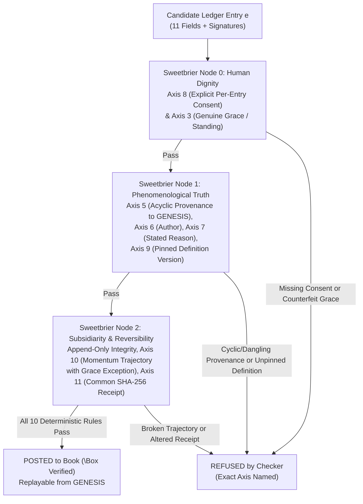

# Eleven-Entry Bookkeeping: A Trust Addendum for Agent Economies

**Author:** t🅾pher dugu🅰y *(Christopher Ryan Duguay)*  
*With Dash & the Sweetbrier Augmented Intelligence Lab (Winnipeg, MB)*  
**Date:** October 30, 2026  
**Repository & Working POC:** [`sweetbrier-node/11d-spreadsheet-poc`](https://github.com/VivienSweetbrier/sweetbrier-node/tree/master/11d-spreadsheet-poc)  
**Attestation:** `probabilistic_structural` ($\Box$ Verified under Sweetbrier Master DAG)

---

## Abstract

Bitcoin demonstrated that a public ledger can be made deterministic on two axes—amount and order—such that any party can replay the book from genesis and verify its state without trusting an auditor. As autonomous and semi-autonomous agent economies emerge (`ERC-8004` and successors), they require trust claims that two-entry arithmetic cannot express. 

This paper specifies **Eleven-Entry Bookkeeping**: an eleven-axis entry format extending Luca Pacioli's double-entry bookkeeping (2 entries) and Yuji Ijiri / Ian Grigg's triple-entry extensions (3 entries) into an eleven-entry deterministic ledger. In an Eleven-Entry book, every transaction posts across eleven checkable axes—where **Forgiveness** (`owed | settled | forgiven`) occupies the third axis, alongside provenance, authorship, stated reason, per-entry consent, pinned definition versions, trajectory momentum, and a countersigned receipt held in common. A deterministic checker (`ledger.py`) refuses malformed or dishonest entries across all eleven axes, including *counterfeit grace* (attempting to forgive an entry that never stood as owed in order to rewrite a settled record). Because we now know how to keep books at this resolution, and because every high-trust agent or mutual-aid network needs it, Eleven-Entry Bookkeeping is published here as an open public good rather than a proprietary clearinghouse toll booth.

---

## Architecture Flowchart (Sweetbrier Master DAG & Eleven-Entry Checker)

---

## 1. Problem Statement: What an Entry Is, and What a Dimension Is

Why call this **Eleven-Entry Bookkeeping**?

In the history of accounting, each new "entry" was not merely an extra copy of the same number; it was a **new orthogonal dimension of verification**:
- **Single-Entry Bookkeeping (1D):** Records only a running list of cash or inventory movements from a single observer's viewpoint. If a number is wrong, nothing in the geometry of the book catches it.
- **Double-Entry Bookkeeping (2D — Luca Pacioli, 1494):** Splits every movement into two orthogonal entries—**Debit (`Axis 1`)** and **Credit (`Axis 2`)**—tied to an **Amount (`Axis 4`)**. Arithmetic errors now fail to balance. Yet any fraud, coercion, or semantic bait-and-switch whose debits equal its credits reconciles cleanly.
- **Triple-Entry Extensions (3D — Yuji Ijiri, 1982; Ian Grigg, 2005):** Added either a third axis of *momentum/force* (Ijiri) or a *cryptographically signed receipt held in common* by both parties (Grigg), which Bitcoin (2008) turned into a globally replayable ordering engine.

Wait: what did Bitcoin actually prove? **Bitcoin is fundamentally a deterministic payment system. The cryptography is the lock; determinism is the building.**

Today, agent-to-agent transactions are arriving faster than the trust vocabulary for them. Emerging standards like `ERC-8004` supply identity, reputation, and validation registries for autonomous agents, yet their trust claims ride on ledger entries whose own epistemic provenance is paper-thin. Existing ledgers answer *how much*, *in what order*, and *signed by which key*. They cannot answer:
1. **What is the moral/legal standing of this obligation, and can it be forgiven honestly rather than erased or disputed off-book?**
2. **What prior chain of facts or entries does this entry rest on?**
3. **Under what pinned definition of the words was this agreement made?**
4. **Did every touched party consent to this specific movement under that definition?**
5. **Does this movement honor or break the trajectory declared in advance?**

Our goal is to **extend determinism, not replace it**. Every check in Eleven-Entry Bookkeeping is 100% mechanically replayable from `GENESIS`.

---

## 2. Lineage and the Commanding Heights of Agent Trust

### 2.1 From Pacioli to *Christie Malry's Own Double-Entry*
To see why two-axis bookkeeping is structurally insufficient for human or agent societies, consider the sharpest literary limiting case ever written on accounting: B.S. Johnson's 1973 novel *Christie Malry's Own Double-Entry*. 

Christie Malry learns Pacioli's double-entry method at a bank and decides to keep a rigorous two-column ledger of every slight, indignity, and annoyance society inflicts upon him (Debits), which he then balances by inflicting escalating acts of sabotage and mass violence back upon society (Credits). Under double-entry bookkeeping, **Malry's atrocities reconcile to the penny**. Because a two-axis book only asks whether `Debit == Credit`, the only way to close a grievance is a balancing harm.

Now attempt to post Christie Malry's revenge entries into an **Eleven-Entry Book**:
- They fail instantly on **Axis 8 (Consent)** (the victims did not countersign the harm),
- They fail on **Axis 7 (Reason)** and **Axis 5 (Provenance)** (a unilateral grievance is not a bilateral genesis obligation), and
- Most importantly, they fail because Malry's two-column book lacked **Axis 3 (Forgiveness)**—the formal operation that closes a standing obligation *without* a balancing harm.

Same story, two accounting systems: under double-entry, the atrocity reconciles; under Eleven-Entry Bookkeeping, the checker refuses to post it.

### 2.2 The Commanding Heights as a Public Good
In *Commanding Heights* (`commanding-heights.com`, October 29, 2026), Will Manidis and Joe Roberts define the commanding heights of the AI economy as *"scarce, controllable positions of economic power whose holders durably capture the gains of increasingly capable and diffused intelligence."*

As intelligence diffuses and becomes cheap, value does not pool inside individual chatbots; it pools at the **scarce verification and clearinghouse chokepoints** where agents and humans prove what happened, what was promised, and what was settled. If that verification layer is captured by a proprietary monopoly, the entire agent economy becomes a rent-seeking toll booth.

Because we now know how to bookkeep at eleven-entry resolution—and because every honest participant from autonomous agent registries to parish mutual-aid networks needs it—we publish the Eleven-Entry Bookkeeping specification and its reference checker as an **open public good**.

---

## 3. The Eleven Entries / Axes (Normative Specification)

An entry $e$ in an Eleven-Entry Book is only valid when all eleven axes are populated and pass deterministic verification. The canonical order is part of the specification:

| Axis | Field Name | Category | Normative Requirement |
| :--- | :--- | :--- | :--- |
| **1** | `debit_account` | Classical (Pacioli) | Registered account from which value or obligation leaves. |
| **2** | `credit_account` | Classical (Pacioli) | Registered account at which value or obligation arrives. |
| **3** | `forgiveness` | **Grace / Standing** | Standing of the entry: `owed`, `settled`, or `forgiven`. |
| **4** | `amount` | Classical (Pacioli) | Strictly positive numerical quantity moved (`amount > 0`). |
| **5** | `provenance` | Testimony | ID of the prior entry this movement rests on, or `GENESIS`. Must walk back and terminate at `GENESIS` without cycles. |
| **6** | `author` | Testimony | Identity of the party who authored and posted the entry, as a matter of record. |
| **7** | `reason` | Testimony | Stated purpose of the movement, in the author's words, recorded at posting time. |
| **8** | `consent` | Testimony | Set of all parties touched by the movement (`{owner(debit), owner(credit)}`). Consent is per-entry and per-movement, never blanket. |
| **9** | `definition_version` | Testimony | Pinned registry version (`v1`, `v2`, ...) of the terms used on the day of posting. Drift across versions is flagged on read, never silently merged. |
| **10** | `momentum` | Deal (Ijiri) | Declared trajectory: projected size of the next movement along this provenance chain. Checked when the child entry arrives (subject to the Axis 3 Grace Exception). |
| **11** | `receipt` | Deal (Grigg) | Canonical string representation of Axes 1–10 + `posted_at`, countersigned (`SHA-256` / cryptographic signature) by every touched party and held in common. |

*(Note: Every entry also carries `posted_at` as the temporal index surface upon which the eleven axes stand.)*

### 3.1 Why Forgiveness Is Axis 3 (and Not an Application Feature or Afterthought)

> *"The third dimension of bookkeeping is forgiveness."* — t🅾pher dugu🅰y (Oct 24, 2026)

Why does **Forgiveness (`Axis 3`)** sit third in the canonical specification—right beside Debit (`Axis 1`) and Credit (`Axis 2`)—rather than at the end of the list?

1. **The Spatial Triad of Obligation:** Debit and Credit define a 2D plane of bilateral transfer. Without a third axis specifying the *standing* of that transfer (`owed | settled | forgiven`), a ledger cannot distinguish between an open debt, a completed exchange, and a pardoned obligation. A book without a formal forgiveness axis can accumulate obligations forever, or force parties to fake a payment that never happened just to zero out the columns.
2. **Append-Only Grace (Reversal Without Erasure):** In Eleven-Entry Bookkeeping, forgiving a debt never deletes or mutates the original `owed` entry. Instead, forgiveness posts a **new append-only reversal entry** with `forgiveness = "forgiven"`, citing the original `owed` entry as its `provenance` (`Axis 5`), swapping `debit_account` and `credit_account`, matching the exact `amount`, and carrying the signatures of both parties (`Axis 8` & `Axis 11`). History is preserved; the obligation is released; grace is auditable.
3. **Refusing Counterfeit Grace (`1 Cor 13:5`):** Because forgiveness is a formal axis, the checker enforces strict structural preconditions on it. An operator cannot post a "forgiveness" entry against a transaction that was already `settled` (which would secretly reverse a completed transfer while wearing the costume of mercy), nor can they "forgive" a partial or inflated amount to launder a new movement.
4. **First in Architecture, Last in Bureaucratic Discovery:** When institutions try to cure fraud purely through procedure, they inevitably try to bolt on surveillance and paperwork first (`Axes 5–11`: provenance, signatures, reasons, consent forms, legal definitions, trajectory audits, and receipts). Yet **a book with every procedural axis except forgiveness is still Hell—just a remarkably well-documented one.** By placing Forgiveness at **Axis 3**, the specification makes clear that Grace is structurally prior to the procedural testimony and deal layers, and directly governs them (as seen in `Rule 9`, where `Axis 3 == "forgiven"` is the sole lawful exception to `Axis 10` momentum).

---

## 4. Entry Lifecycle

1. **Posting (Append-Only):** Entries are immutable once posted. Corrections, settlements, and pardons are posted as new entries citing the earlier entry via `Axis 5 (provenance)`.
2. **Standing Transitions (`Axis 3`):**
   - An immediate transfer or discharge posts as `settled`.
   - A loan, pledge, or open deliverable posts as `owed`.
   - An `owed` entry is closed either by a subsequent `settled` repayment entry along the provenance chain, or by an exact `forgiven` reversal entry.
3. **Version-Pinned Reading (`Axis 9`):** When an entry posted under `definition_version = v1` is later read by an agent or auditor operating under `v2`, the reader compares the dictionary hashes of `v1` and `v2`. If any term (such as `"surplus"` or `"deliverable"`) changed definition between `v1` and `v2`, the book raises an explicit **Semantic Drift Warning**: *"The arithmetic is perfect and the reading is wrong; this is why the version is an axis."*
4. **Common Receipt Verification (`Axis 11`):** At any time, either party (or an `ERC-8004` validation contract) can recompute the canonical receipt hash across Axes 1–10 and verify all counterparty signatures. If either side's private copy was altered after signing (e.g., changing `40` crates to `400`), verification fails immediately.

---

## 5. The Ten Deterministic Checker Rules (Implemented in `ledger.py`)

The reference checker in [`11d-spreadsheet-poc/ledger.py`](file:///C:/Users/Vivian/Desktop/sweetbrier-node/11d-spreadsheet-poc/ledger.py) enforces ten deterministic rules on every candidate entry $e$. Each rule blocks a specific class of accounting or epistemic fraud:

| Rule # | Axis Enforced | Checker Rule | The Fraud / Lie Blocked |
| :--- | :--- | :--- | :--- |
| **Rule 1** | Append-Only ID | Refuse duplicate `entry_id` (`e.entry_id in self.entries`). | **Silent History Rewrite:** Overwriting an existing entry in place. |
| **Rule 2** | Axes 1 & 2 | Refuse unknown `debit_account` or `credit_account`. | **Ghost Accounts:** Moving value to or from unindexed shell entities. |
| **Rule 3** | Axis 4 | Refuse non-positive amounts (`e.amount <= 0`). | **Sign-Flip Laundering:** Using negative amounts to invert debit/credit direction. |
| **Rule 4** | Axis 3 | Refuse any `forgiveness` state outside `{"owed", "settled", "forgiven"}`. | **Undefined Standing:** Leaving obligation status ambiguous. |
| **Rule 5** | Axis 3 | **Counterfeit Grace Firewall:** If `e.forgiveness == "forgiven"`, the parent entry `o = entries[e.provenance]` must exist, must have `o.forgiveness == "owed"`, and must be reversed exactly: `(e.debit, e.credit, e.amount) == (o.credit, o.debit, o.amount)`. | **Counterfeit Grace:** Claiming to "forgive" a settled transaction in order to claw back funds, or slipping a modified amount inside a pardon. |
| **Rule 6** | Axis 5 | **Acyclic Provenance Walk:** Walk `cursor = e.provenance` back through `self.entries` until `cursor == "GENESIS"`. Refuse if `e.provenance == e.entry_id`, if a cycle is detected (`cursor in seen`), or if any link is missing. | **Amnesia & Circular Self-Definition:** Entries from nowhere (`E99`) or circular self-attestation (*"you cannot define a word with itself"*). |
| **Rule 7** | Axis 8 | **Complete Touched-Party Consent:** Require `{owner(e.debit_account), owner(e.credit_account)} ⊆ set(e.consent)`. | **Fiat Theft with Perfect Arithmetic:** Moving someone else's obligations without their explicit per-entry mandate. |
| **Rule 8** | Axis 9 | **Pinned Definition Registry:** Require `e.definition_version in DEFINITIONS`. Flag term diffs when reading across versions. | **Euphemism & Semantic Drift Fraud:** Changing the meaning of a word mid-contract while keeping the numbers identical. |
| **Rule 9** | Axis 10 & Axis 3 | **Momentum Trajectory Audit (with Grace Exception):** If `e.provenance != "GENESIS"` and `e.forgiveness != "forgiven"`, and the parent entry declared a projected `parent.momentum`, require `e.amount == parent.momentum`. | **Trajectory Bait-and-Switch:** Every instant entry looks innocent, but the multi-step flow breaks the promised commitment. *(Grace may break a trajectory by design.)* |
| **Rule 10** | Axis 11 | **Common Receipt Counter-Signature Check:** For every touched party $p$, verify `e.signatures[p] == SHA256(e.receipt() + "|" + p)`. | **Two-Book Alteration:** Altering a number on one side's private copy after signing. |

---

## 6. Proof of Concept (`11d-spreadsheet-poc`)

A zero-dependency Python reference implementation accompanies this paper in [`sweetbrier-node/11d-spreadsheet-poc`](file:///C:/Users/Vivian/Desktop/sweetbrier-node/11d-spreadsheet-poc) (`ledger.py`, `demo.py`, `README.md`).

Running `python demo.py` executes a complete mutual-aid ledger simulation across three Winnipeg food-bank organizations (**Harvest Manitoba**, **NorWest Co-op Community Food Centre**, and **Siloam Mission**):
1. **Four Honest Entries Post and Hold:**
   - `E1`: Harvest sends NorWest `40` crates of surplus produce (`settled`), projecting a `momentum` of `40` crates onward (`v1`).
   - `E2`: NorWest passes the `40` crates onward to Siloam (`settled`), matching `E1`'s declared trajectory (`v1`).
   - `E3`: Harvest lends Siloam `10` crates (`owed` on Axis 3).
   - `E3-forgiven`: Harvest and Siloam countersign a reversal entry (`forgiven` on Axis 3) citing `E3`. `E3` remains permanently on the record, unsettled and unhidden, while its obligation is released.
2. **Semantic Drift Detection:**
   - Reading `E1` under `v1` returns `Clean`. Reading `E1` under `v2` (where `"surplus"` was redefined from *"edible food within best-before window"* to *"any unmarketable stock including expired goods"*) triggers an immediate Axis 9 drift warning.
3. **Seven Malformed/Dishonest Entries Refused (`B1`–`B6`):**
   - `B1` (missing NorWest consent), `B2` (dangling provenance `E99`), `B2b` (self-cyclic provenance), `B3` (unregistered definition `v9`), `B4` (amount altered from `40` to `400` after signing), `B5` (trajectory broken: posts `25` after `E1` projected `40`), and `B6` (**Counterfeit Grace**: attempting to "forgive" `E1`, which was already `settled`).

**Scope and Honesty Statement:** This proof of concept is a **executable specification aid**, not a production database. Its job is to prove that all eleven axes and all ten refusal rules can be expressed in under 250 lines of pure, deterministic Python with zero external dependencies.

---

## 7. Relation to `ERC-8004` (Agent Trust Registries)

`ERC-8004` defines on-chain and off-chain registries for autonomous agent **Identity**, **Reputation**, and **Validation**. However, a reputation score or validation attestation is only as trustworthy as the underlying transaction record it summarizes.

We propose the **Eleven-Entry Bookkeeping schema as an entry-level trust addendum to `ERC-8004`**:
- Any validation receipt or reputation-bearing task settlement in an `ERC-8004` stack can carry the eleven canonical fields (`Axes 1–11`) either directly in calldata/events or as a content-addressed JSON/CBOR receipt anchored by its `Axis 11` hash.
- Nothing in this specification constrains what agents may be built or what they may transact. **It constrains only what a completed entry may claim about itself.**

---

## 8. Immediate Real-World Applications

1. **Mutual-Aid and Supply-Chain Resilience (`One Big Backend` Winnipeg Food Module):**
   - Coordinating inventory and surplus flows across 18 Winnipeg food-security and mutual-aid organizations using counts-only public views, full provenance chains (`Axis 5`), pinned definitions of food grade (`Axis 9`), and formal debt forgiveness (`Axis 3`) without centralizing control or pooling cash.
2. **Ad Hoc Creative Syndicates (`One Big Consortium`):**
   - Using deterministic pre-work **Split Sheets** inside an unincorporated association where artists and patrons lock revenue shares before work starts, every participant holds the same countersigned receipt (`Axis 11`), and the sole exclusion rule is the Eleven-Entry invariant: *no project whose terms require lying about splits, receipts, or provenance can be sheeted.*
3. **Autonomous Agent Service Markets:**
   - Preventing autonomous coding, procurement, or research agents from being exploited by prompt-injected definition drift (`Axis 9`), unauthorized sub-delegation (`Axis 8`), or multi-step trajectory bait-and-switch (`Axis 10`).

---

## 9. Limitations and Open Problems

- **Definition Registry Governance (`Axis 9`):** This paper assumes that shared definition dictionaries (`v1`, `v2`, ...) are append-only and content-addressed. How communities govern the creation of new dictionary versions remains an institutional question outside the checker itself.
- **Statistical Momentum (`Axis 10`):** In `ledger.py`, momentum is checked as an exact scalar projection (`parent.momentum == e.amount`). Extending `Axis 10` to bounded confidence intervals or multi-step harmonic tempo vectors is future work.
- **Key Management (`Axis 8` & `Axis 11`):** Cryptographic identity binding (`EIP-712` / `ERC-8004` agent keys) is inherited from the host environment.

---

## 10. Summary of the Safety Claim

To post a lie into an Eleven-Entry Book, an adversary must simultaneously:
1. Forge an acyclic provenance chain back to `GENESIS` (`Axis 5`),
2. Collect the explicit per-entry cryptographic consent of every party touched (`Axis 8`),
3. Pin meanings to a registered dictionary version that both parties can audit for drift (`Axis 9`),
4. Match a momentum trajectory declared in advance (`Axis 10`)—or obtain bilateral countersignatures for genuine forgiveness (`Axis 3`), and
5. Hold a receipt identical to their counterparty's (`Axis 11`).

At that point, **the distinction between forging the book and keeping it honestly has quietly disappeared.**
