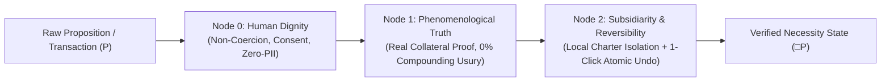

# Sweetbrier Node (`sweetbrier-node`)

**Deterministic Augmented Intelligence (AuI), Categorical Modal Verification ($\Box$), and Real-Asset Fiduciary Clearing**  
*License: GNU AGPLv3 | Attestation: `probabilistic_structural`*

---

## 1. Overview: Why Dignity Requires Structural Teeth

A common misconception is that ethical frameworks built on **Human Dignity** or **Charity** must be passive, permissive, or easily exploited by bad-faith actors.

In classical **Thomistic philosophy** (St. Thomas Aquinas, *Summa Theologiae*), the exact opposite is true: **Dignity is inseparable from Objective Truth and Justice.** A contract built on fraud, hidden ambiguity, or predatory compounding usury is *ontologically void*.

**Sweetbrier Node** translates these classical principles into a deterministic, three-gate symbolic verification pipeline (the **Sweetbrier Master DAG**) that wraps around language models, state engines, and financial clearing workflows:



1. **Node 0 — Human Dignity (Primary Invariant):** Enforces non-coercion, explicit mutual consent, and a strict Zero-PII safety floor ([`ObbSafetyFloor`](core/obb_primitives.py)).
2. **Node 1 — Phenomenological Truth (Epistemic Invariant):** Rejects synthetic paper claims, phantom invoices, and unbacked compounding interest. Every state transition or financial facility must be backed by cryptographic provenance ([`ObbLibraryLedger`](core/obb_primitives.py)) and tangible collateral ([`SweetbrierFiduciaryClearingNode`](core/sweetbrier_islamic_compliance.py)).
3. **Node 2 — Subsidiarity & Reversibility (Operational Invariant):** Operates at the most local charter scope possible and guarantees **100% bilateral atomic rollback** ([`ObbUndoEngine`](core/obb_primitives.py)) so any breach or error cleanly restores prior state.

---

## 2. The Institutional Rosetta Stone: Thomistic Ethics $\leftrightarrow$ Credit Unions $\leftrightarrow$ Real-Asset Finance

The core engine in [`core/sweetbrier_islamic_compliance.py`](core/sweetbrier_islamic_compliance.py) demonstrates a mathematical isomorphism across three traditions that rarely realize they are writing the exact same equations:

| Classical Thomistic & Ethical Principle | Prairie Credit Union / Co-op "Bankspeak" | Open-Source Software Primitive (`core/`) |
| :--- | :--- | :--- |
| ***Societas* / Risk-Sharing Partnership** | **Member-Owned Cooperative Joint Venture & Patronage Dividend** | `FacilityStructure.COOP_JOINT_VENTURE` |
| **Just Price & Real Goods Exchange** | **Verified Inventory Cost-Plus Trade Facility (Warehouse Receipt)** | `FacilityStructure.INVENTORY_COST_PLUS` |
| **Productive Usufruct Lease** | **PPSA Tangible Equipment Operating Lease SPV** | `FacilityStructure.EQUIPMENT_LEASE_SPV` |
| **Ban on *Usura* / *Riba* (Sterile Debt)** | **0.00% Unbacked Compounding APR ( eliminates 60%+ debt bloat)** | `verify_node_1_collateral_truth()` |
| **Anti-Fraud / Anti-*Soori* (Real Title)** | **Cryptographic Bill-of-Lading & Physical Appraisal Audit** | `TangibleCollateralProof` |
| **Mutual Rescission (*Iqalah* / Forgiveness)** | **100% Bilateral Par-Value Atomic Unwind** | [`ObbUndoEngine.undo()`](core/obb_primitives.py) |
| **Principle of Subsidiarity** | **Local Credit Union Charter Autonomy & Corridor Ring-Fencing** | [`ObbSafetyFloor`](core/obb_primitives.py) & `CorridorScope` |

---

## 3. Repository Structure

The repository is organized into four clean, modular directories:

```text
sweetbrier-node/
├── core/                  # Deterministic engines, state primitives & formal schemas
│   ├── obb_primitives.py                 # Zero-PII Safety Floor, SHA-256 Ledger, 1-Click Atomic Undo
│   ├── sweetbrier_islamic_compliance.py  # Fiduciary & Co-op Real-Asset Clearing Engine
│   ├── Sweetbrier_Core/                  # Core DAG routing & epistemic firewall modules
│   ├── contracts/                        # Formal contract definitions
│   ├── schemata/                         # JSON & structural type schemas
│   ├── mora_rsi_engine.py                # Recursive stability & verification engine
│   └── sweetbrier_topology.json          # Node graph topology definition
├── apps/                  # Servers, User Interfaces, LSP, and IDE Integrations
│   ├── api/                              # REST / RPC interface layer
│   ├── sweetbrier_node_ui/               # Visual Centaur & dashboard UI
│   ├── vscode-extension/                 # VS Code extension client
│   ├── sophia_server.py                  # Local sanctuary server
│   └── sweetbrier_lsp.py                 # Language Server Protocol implementation
├── benchmarks/            # Empirical evaluation harnesses & reproducible smoke tests
│   ├── harness/                          # D-separation & axiom evaluation suites
│   ├── examples/                         # Example workflows & test cases
│   └── smoke_test.py                     # Fast end-to-end verification script
└── docs/                  # Architectural manifestos, research papers & project lore
    ├── LORE_AND_MANIFESTO.md             # Original Sweetbrier / Sock / Shrub artistic manifesto
    ├── RSI_MANIFESTO.md                  # Recursive structural integrity notes
    ├── LAUNCH_KIT.md                     # Release & onboarding guide
    └── competition/                      # Formal philosophy & decision-theory essays
```

---

## 4. Quickstart

Run the deterministic core primitives and the cooperative asset clearing engine directly with Python 3 (zero external dependencies required):

```bash
# 1. Verify Zero-PII Safety Floor, SHA-256 Provenance Ledger, and 1-Click Atomic Undo
python core/obb_primitives.py

# 2. Run the Fiduciary & Co-op Real-Asset Clearing Engine (Phase 1 Evisceration + Phase 2 SPV Clearing)
python core/sweetbrier_islamic_compliance.py
```

---

## 5. License

Licensed under the **GNU Affero General Public License v3.0 (AGPLv3)**. See [LICENSE](LICENSE) for full details.
