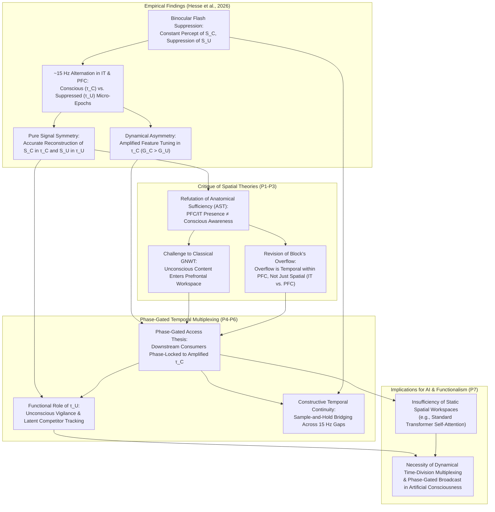

# Consciousness Beyond the Spatial Broadcast: Temporal Multiplexing, Phase-Gated Access, and the Architecture of Subjective Awareness

## Abstract

Leading neurocomputational theories of consciousness—most notably Global Neuronal Workspace Theory (GNWT), Higher-Order Thought (HOT) theories, and Recurrent Processing Theory (RPT)—rely on a common structural premise: the *Spatial-Amplitude Broadcast Assumption*. On this view, what distinguishes a conscious mental representation from an unconscious (suppressed) representation is either its anatomical localization (whether it enters prefrontal-parietal workspaces or remains confined to early sensory cortices) or its sustained macro-scale persistence. However, neurophysiological recordings by Hesse et al. (2026) using Neuropixels across inferotemporal (IT) and prefrontal cortex (PFC) during binocular flash suppression overturn this consensus. Hesse et al. show that during a constant conscious percept, both IT and PFC rapidly alternate (~15 times per second) between "conscious micro-epochs" and "suppressed micro-epochs," selectively encoding the perceived stimulus in one phase and the invisible, suppressed stimulus in the alternating phase. 

In this paper, I argue that these findings require shifting the philosophy of consciousness from spatial localization to *Phase-Gated Temporal Multiplexing*. First, the presence of pure, reconstructible representations of suppressed stimuli within PFC during suppressed micro-epochs refutes anatomical-entry versions of GNWT, HOT theory, and spatial formulations of Ned Block's overflow argument. Second, I formulate the *Phase-Gated Temporal Multiplexing (PGTM) Thesis*, arguing that conscious access consists in temporal phase-alignment between amplified representational micro-epochs and downstream consumer systems, whereas phenomenal continuity across 15 Hz interruptions is an actively constructed "sample-and-hold" bridging representation. Third, I apply this framework to artificial consciousness (Chalmers, Butlin et al., Millière, Shevlin), showing that static spatial indicator properties in AI architectures (such as Transformer self-attention) are insufficient without dynamical time-division multiplexing and phase-gated execution.

---

## 1. Introduction: The Spatial Bias in Contemporary Theories of Consciousness

For over three decades, the search for the neural correlates of consciousness (NCC) has been framed in spatial and anatomical terms. In binocular rivalry or binocular flash suppression (BFS), two distinct images are continuously presented to the two eyes, yet the observer consciously perceives only one stimulus ($S_C$) at a time, while the other ($S_U$) remains invisible—suppressed from phenomenal awareness (Logothetis & Schall, 1989; Wolfe, 1984). The central explanatory question is straightforward: *What distinguishes the neural representation of the consciously perceived stimulus ($S_C$) from that of the suppressed, unconscious stimulus ($S_U$)?*

Across the major adversarial camps in the neuroscience and philosophy of consciousness, prevailing answers appeal to what I call the **Spatial-Amplitude Broadcast Assumption (SABA)**. According to SABA, a representation $R$ becomes conscious if and only if either:
1. **Anatomical Localization / Spatial Broadcast:** $R$ crosses an anatomical threshold from modular sensory cortices into a fronto-parietal network—the "Global Neuronal Workspace" (Dehaene & Naccache, 2001; Dehaene, Changeux, Naccache, Sackur, & Sergent, 2006; Mashour, Roelfsema, Changeux, & Dehaene, 2020)—or becomes targeted by a meta-representation in prefrontal cortex (Higher-Order Thought theories; Lau & Rosenthal, 2011; Brown, Lau, & LeDoux, 2019); or
2. **Sustained Macro-Scale Recurrent Amplitude:** $R$ achieves a sustained, temporally continuous state of local recurrent feedback within posterior sensory cortices that dominates competing representations over the macro-epoch of the percept, while the suppressed representation is attenuated to noise (Lamme, 2006, 2010; Block, 2005, 2007).

Despite debates over whether prefrontal cortex (PFC) is constitutive of phenomenal consciousness ($P$-consciousness) or merely cognitive access ($A$-consciousness) (Block, 1995, 2007; Dehaene, 2014), both camps have assumed that during a stable conscious percept of $S_C$ lasting several seconds, the neural machinery of high-level visual representation (inferotemporal cortex, IT) and executive access (PFC) is continuously dedicated to representing $S_C$, while $S_U$ is gated out prior to these areas or reduced to weak noise.

Recent findings by Janis K. Hesse, Frank F. Lanfranchi, Conor McGrory, Yuelin Shi, Tatiana A. Engel, and Doris Y. Tsao (2026) shatter this assumption. Using Neuropixels recordings across multiple face patches in primate IT and PFC during binocular flash suppression, Hesse et al. discovered that the brain does not maintain a continuous representation of the conscious stimulus during a constant percept. Instead, neural populations in both IT and PFC rapidly alternate—roughly 15 times per second (~15 Hz, or ~33 ms per half-cycle)—between **conscious micro-epochs** and **suppressed micro-epochs**.

During conscious micro-epochs, neural activity across IT and PFC carries a "pure signal" of the perceived stimulus ($S_C$), permitting accurate reconstruction of the conscious face image from population activity while single neurons respond selectively to $S_C$ and not $S_U$. Astonishingly, during interleaved suppressed micro-epochs, this selectivity reverses: single neurons and population activity in *both* IT and PFC selectively track the suppressed, invisible stimulus ($S_U$), allowing accurate reconstruction of the suppressed image while the conscious image vanishes from the active code. Despite this representational symmetry, the two micro-epochs are reliably distinguished by a dynamical asymmetry: **feature tuning is specifically amplified during conscious micro-epochs** compared to suppressed micro-epochs. As Hesse et al. (2026) conclude, "both inferotemporal and prefrontal cortex rapidly interleave conscious with suppressed content, indicating that conscious access requires temporal selection beyond localization."

This paper investigates the philosophical consequences of rapid neural alternation between conscious and suppressed representations. I defend the **Phase-Gated Temporal Multiplexing (PGTM) Thesis**, which comprises three core claims:

1. **Refutation of Anatomical-Spatial Sufficiency:** The presence of pure, selective, reconstructible representations of suppressed stimuli in both IT and PFC during suppressed micro-epochs falsifies any theory holding that anatomical entry into PFC or categorical selectivity in high-level visual cortex is *sufficient* for phenomenal consciousness or cognitive access.
2. **Consciousness as Phase-Gated Temporal Alignment:** The boundary between conscious and unconscious processing—and Block's $P/A$ distinction—must be reconceptualized via *time-division multiplexing* (TDM). A representation is consciously accessed not by its anatomical location alone, but by its allocation to an amplified **duty-cycle phase** temporally synchronized (phase-locked) with downstream executive and mnemonic consumers.
3. **Architectural Implications for Artificial Consciousness:** Contemporary evaluations of consciousness and cognitive access in Large Language Models (LLMs) and multimodal AI (Chalmers, 2023; Butlin et al., 2023; Millière, 2024; Shevlin, 2024) rely on spatial-structural analogies to Global Workspace Theory (such as Transformer self-attention). If biological conscious access is gated by temporal phase-multiplexing that separates background competitor monitoring from foreground committed broadcast, then static, synchronous, single-pass feedforward architectures lack the dynamical mechanisms required for conscious access.

Section 2 presents the formal definitions, premises, and Directed Acyclic Graph (DAG) of the argument. Section 3 analyzes how 15 Hz alternation undermines spatial formulations of GNWT, HOT theory, and Block's overflow argument. Section 4 explains the teleological function of multiplexing and how sample-and-hold integration constructs *phenomenal continuity* across 15 Hz neural gaps. Section 5 examines implications for computational functionalism and AI consciousness. Section 6 replies to four major objections, and Section 7 concludes.

---

## 2. Formal Argument Structure and Conceptual Clarifications

### 2.1 Core Definitions and Distinctions

* **Stimulus Condition ($S_C, S_U$):** Under binocular flash suppression (BFS), two distinct visual stimuli are continuously presented over a macroscopic interval $T = [t_0, t_n]$. $S_C$ denotes the stimulus dominating subjective awareness throughout $T$; $S_U$ denotes the stimulus phenomenally suppressed (invisible to the subject) throughout $T$.
* **Conscious Micro-Epoch ($\tau_C$) vs. Suppressed Micro-Epoch ($\tau_U$):** Sub-intervals of duration $\Delta t \approx 33\text{ ms}$ alternating at $f \approx 15\text{ Hz}$ within $T$. During $\tau_C$, single-unit and population firing in IT and PFC selectively encode $S_C$ (permitting accurate reconstruction of $S_C$) with amplified feature tuning ($G_C$). During $\tau_U$, single-unit and population firing in the *same* regions IT and PFC selectively encode $S_U$ (permitting accurate reconstruction of $S_U$) with unamplified baseline feature tuning ($G_U$, where $G_C > G_U$).
* **Anatomical Sufficiency Thesis (AST):** The thesis that the presence of a high-fidelity, selective, categorical neural representation of a stimulus $S$ within prefrontal and high-level association cortices (IT/PFC) is constitutively sufficient for $S$ to be consciously experienced or cognitively accessed.
* **Spatial Overflow vs. Temporal Overflow:** *Spatial Overflow* (Block, 2007) holds that the representational capacity of posterior perceptual buffers (V4/IT) exceeds that of the prefrontal access workspace at a given time $t$. *Temporal Overflow*, introduced here, holds that within the *very same* anatomical network (including PFC itself), the total set of pure, high-fidelity representations processed across a temporal cycle $(\tau_C + \tau_U)$ exceeds the subset selected by phase-gated amplification for conscious broadcast during $\tau_C$.
* **Phase-Gated Temporal Multiplexing (PGTM):** A neurocomputational architecture in which a single anatomical network processes multiple competing informational streams by rapidly switching between them in discrete time-slices (time-division multiplexing), while restricting executive broadcast, working memory consolidation, and reportability to the specific phase ($\tau_C$) characterized by amplified feature tuning and downstream phase-locking.

### 2.2 Explicit Deductive and Abductive Premises

1. **Premise 1 (Empirical Alternation in IT and PFC):** During binocular flash suppression where $S_C$ is continuously perceived and $S_U$ is continuously suppressed, neural populations in both IT and PFC alternate at ~15 Hz between conscious micro-epochs ($\tau_C$) selectively representing $S_C$ and suppressed micro-epochs ($\tau_U$) selectively representing $S_U$ (Hesse et al., 2026).
2. **Premise 2 (Representational Purity of Suppressed Micro-Epochs):** During $\tau_U$, the neural representation of $S_U$ in both IT and PFC is not degraded noise or a mixed superposition, but a "pure signal": single neurons respond selectively to $S_U$ (and not $S_C$), allowing accurate reconstruction of $S_U$ from population activity.
3. **Premise 3 (Falsification of Anatomical Sufficiency):** If a pure, reconstructible, single-cell selective representation of $S_U$ is regularly instantiated in both IT and PFC during $\tau_U$ while the subject remains unaware of and unable to report $S_U$, then anatomical localization and representational fidelity in IT and PFC are *not* sufficient for either phenomenal consciousness ($P$-consciousness) or cognitive access ($A$-consciousness). *(From P1, P2)*
4. **Premise 4 (Dynamical Asymmetry and Phase-Gating):** The systematic neural distinction between $\tau_C$ and $\tau_U$ across IT and PFC is a dynamical modulation: feature tuning is amplified during $\tau_C$ ($G_C > G_U$) and coupled to a specific temporal phase of the ~15 Hz cycle.
5. **Premise 5 (The Phase-Gated Temporal Multiplexing Thesis):** Conscious access is constituted not by static spatial entry into a prefrontal workspace, but by *temporal selection via phase-gated amplification*: downstream consumer systems (working memory, motor planning, verbal report, episodic consolidation) are phase-locked to read out from IT/PFC exclusively during the amplified $\tau_C$ phase, while $\tau_U$ serves an unconscious functional role (attentional vigilance and Bayesian updating of suppressed alternatives). *(From P3, P4)*
6. **Premise 6 (Constructive Phenomenal Continuity):** Because the subject experiences a continuous, flicker-free percept of $S_C$ throughout $T$ despite $S_C$ being absent from IT and PFC firing during every $\tau_U$ phase (~50% of the time), subjective temporal continuity cannot be isomorphic to continuous neural firing in IT/PFC; rather, phenomenal continuity is a discrete, sample-and-hold bridging representation updated at ~15 Hz. *(From P1, P5)*
7. **Premise 7 (Dynamical Constraint on Computational Functionalism and AI):** If conscious access depends on functional organization rather than biological substrate, then the functional organization sufficient for conscious access must include *temporal phase-gating and time-division multiplexing* (or an isomorphic dynamical selection mechanism). Consequently, AI architectures (such as standard autoregressive Transformers) that rely purely on static spatial workspaces (all-to-all cross-attention) without dynamical phase-separation of competing unaccessed hypotheses lack a critical functional mechanism of conscious access. *(From P5, P6)*

### 2.3 Structural Directed Acyclic Graph (DAG) of the Argument

---

## 3. The Collapse of the Spatial Broadcast Consensus and the Rise of Temporal Overflow

To appreciate the philosophical force of Hesse et al.'s (2026) findings, we must examine how deeply the Spatial-Amplitude Broadcast Assumption is embedded in **Global Neuronal Workspace Theory (GNWT)**, **Higher-Order Thought (HOT) Theory**, and **Phenomenal Overflow Theory**.

### 3.1 The Dilemma for Global Neuronal Workspace Theory

In GNWT (Dehaene & Naccache, 2001; Dehaene et al., 2006; Mashour et al., 2020), unconscious processing occurs across modular sensory processors (V1, V2, V4). A stimulus remains unconscious until its activity crosses a non-linear threshold called **global ignition**, propagating via long-range excitatory axons into a fronto-parietal network centered in the prefrontal cortex (PFC). Once inside this prefrontal workspace, the representation is broadcast to motor, memory, and language systems, rendering the content consciously accessible ($A$-conscious) and phenomenally conscious ($P$-conscious).

GNWT relies on an anatomical bottleneck to explain binocular rivalry and flash suppression: because the prefrontal workspace holds only one coherent interpretation at a time, lateral inhibition prevents the suppressed stimulus $S_U$ from entering PFC. Earlier macaque recordings (Leopold & Logothetis, 1996; Sheinberg & Logothetis, 1997; Panagiotaropoulos, Deco, Kapoor, & Logothetis, 2012) averaged spike rates across multi-second epochs, finding partial modulation by the conscious percept alongside residual activity—hence the lament that "a pure signal of conscious perception has not been found anywhere in the brain" (Hesse et al., 2026, p. 1).

Hesse et al. resolve why time-averaged recordings looked impure, posing a sharp dilemma for GNWT. By resolving population dynamics at the millisecond scale without trial-averaging away oscillatory phase, they show that *both* IT and PFC contain a **pure signal** of the conscious stimulus—but only for ~33 ms at a time ($\tau_C$). In the next ~33 ms window ($\tau_U$), the *exact same regions* in IT and PFC switch to carrying a **pure signal** of the suppressed stimulus $S_U$.

This creates a two-horned dilemma for GNWT:
* **Horn 1 (Abandoning Prefrontal Sufficiency):** If PFC is the anatomical seat of the Global Workspace, then during every suppressed micro-epoch $\tau_U$ (15 times per second), the suppressed stimulus $S_U$ *successfully enters and dominates the prefrontal workspace*. Single neurons in PFC selectively fire for $S_U$ and not $S_C$; decoders reconstruct $S_U$ from PFC alone. Yet the subject is blind to $S_U$. Thus, entry into and selective representation within PFC is *not sufficient* for consciousness or global access.
* **Horn 2 (Redefining Ignition as Temporal Phase-Locking):** To save workspace theory, the GNWT proponent must abandon the spatial definition of the workspace ("what is selectively represented in PFC is conscious") and adopt a *temporal-dynamical definition* ("only representations occurring during the amplified phase $\tau_C$ of the ~15 Hz cycle are broadcast to downstream consumers"). 

Taking Horn 2 transforms GNWT: "global ignition" is not a sustained macroscopic state locking out competitors for seconds at a time. Instead, the fronto-parietal network operates as a **Time-Division Multiplexer (TDM)**, devoting roughly half of its temporal cycles to cleanly representing the invisible competitor $S_U$.

### 3.2 Higher-Order Thought (HOT) Theory and Sub-Personal Meta-Representation

A parallel challenge confronts Higher-Order Thought (HOT) and Perceptual Reality Monitoring (PRM) theories (Rosenthal, 2005; Lau & Rosenthal, 2011; Brown et al., 2019; Fleming, 2020), which hold that a first-order visual representation becomes conscious when targeted by a higher-order state in PFC.

In Hesse et al.'s recordings, PFC activity during suppressed micro-epochs ($\tau_U$) closely mirrors IT activity, selectively tracking $S_U$ during $\tau_U$ just as it tracks $S_C$ during $\tau_C$. Why doesn't the prefrontal representation of $S_U$ during $\tau_U$ constitute a higher-order representation rendering $S_U$ conscious 15 times per second?

To explain why $\tau_U$ activity in PFC fails to generate awareness, the HOT theorist must distinguish between:
1. **Unamplified Prefrontal Tracking ($\tau_U$):** A sub-personal monitoring state in PFC that tracks suppressed sensory alternatives without triggering awareness.
2. **Amplified Phase-Gated Meta-Representation ($\tau_C$):** A state with amplified feature tuning ($G_C > G_U$) crossing a precision threshold that licenses subjective commitment ("This stimulus is actually present").

Thus, anatomical presence in PFC does not make a state a consciousness-conferring Higher-Order Thought. What confers conscious status is **dynamical gain modulation ($G_C$) and temporal phase alignment**. In Hakwan Lau's (2019, 2022) perceptual reality monitoring framework, the IT–PFC network alternates at 15 Hz to keep *both* competing retinal hypotheses alive in high-level representation, while using a phase-gated reality-monitoring gate (amplified feature tuning during $\tau_C$) to tag one phase as "real/conscious" and the alternating phase as "suppressed/counterfactual."

### 3.3 Reconceptualizing Ned Block's Overflow Argument: From Spatial to Temporal Overflow

Since Ned Block's (1995, 2005, 2007, 2011) seminal papers, philosophers have debated whether phenomenal consciousness ($P$-consciousness) overflows cognitive access ($A$-consciousness). Block appealed to Sperling's (1960) partial-report paradigm to argue that posterior visual cortex maintains a high-capacity representation of all 12 letters (all $P$-conscious), whereas the prefrontal workspace accesses only 3–4 letters ($A$-consciousness). Critics (Dehaene et al., 2006; Cohen & Dennett, 2011; Phillips, 2011; Naccache, 2018) replied that unaccessed items are represented only as preconscious fragments or generic summary statistics in posterior cortex, never reaching categorical representation in IT or PFC.

Hesse et al.'s (2026) findings reveal **Temporal Overflow within the Prefrontal Workspace itself**:
1. Against the **No-Overflow Model** (Dehaene/Dennett): During $\tau_U$, the suppressed stimulus $S_U$ is *not* blocked from IT or PFC, nor degraded into low-level statistics. It is represented as a **pure, selective, reconstructible face representation** in both IT and PFC. Thus, high-level categorical representation in the IT–PFC network clearly **overflows** conscious reportability ($A$-consciousness).
2. Against **Block's Posterior $P$-Consciousness Model**: If selective, reconstructible representation in IT (or IT+PFC) sufficed for $P$-consciousness, then during every $\tau_U$ epoch (15 times per second), the primate would be **phenomenally conscious of the suppressed face $S_U$**, merely lacking $A$-consciousness of it.

As shown in Section 6.2, this "Stroboscopic Overflow" reading fails because subjects in BFS experience zero phenomenal awareness or 15 Hz flicker of $S_U$, and because Hesse et al. found an intrinsic marker distinguishing $\tau_C$ from $\tau_U$ within IT itself: **amplified feature tuning ($G_C > G_U$)**. Consequently, **representational purity overflows conscious awareness in the temporal domain**. Both IT and PFC maintain two distinct, pure stimulus representations by interleaving them at 15 Hz, while conscious status requires **phase-gated amplification ($\tau_C$)**. What overflows consciousness is an interleaved *temporal shadow channel* ($\tau_U$) running through IT and PFC simultaneously.

---

## 4. The Phase-Gated Temporal Multiplexing (PGTM) Theory of Consciousness

Rapid alternation between conscious and suppressed representations across IT and PFC raises two central questions:
1. **The Teleological Question:** *Why* does the brain dedicate half of its temporal duty cycle in IT and PFC to cleanly representing a stimulus completely suppressed from awareness?
2. **The Phenomenological Continuity Question:** If the neural representation of $S_C$ is shut off in IT and PFC every ~33 ms (replaced by $S_U$), *why doesn't our conscious visual experience flicker or vanish 15 times per second?*

### 4.1 Why Multiplex? Resolving the Stability-Flexibility Dilemma via Time-Division Multiplexing

Any cognitive agent operating in an ambiguous sensory environment faces the **Stability-Flexibility Dilemma**:
* **Perceptual Stability (Commitment):** To guide coherent action and working memory, the system cannot represent a blended superposition of conflicting interpretations (e.g., merging two faces into a chimera). Executive systems require a **single, committed, high-gain interpretation**.
* **Perceptual Flexibility (Vigilance):** If the visual system extinguished suppressed inputs early (e.g., in V1), the organism would become blind to novel threats in the suppressed channel. Psychophysics confirms that invisible stimuli under continuous flash suppression (CFS) and rivalry undergo high-level semantic processing: fearful faces break suppression faster than neutral faces (Yang, Zald, & Blake, 2007), invisible words prime semantic associations (Costello, Jiang, Baartman, McGlennen, & He, 2009), and salient suppressed stimuli capture attention (Mudrik, Breska, Lamy, & Deouell, 2011).

Spatial partitioning in IT/PFC fails because face-patch neurons have broad, overlapping receptive fields and distributed population codes; simultaneous activation would create an uninterpretable linear superposition. Early suppression fails because V1/V2 lack the invariant object representations needed to evaluate whether $S_U$ is an ecologically critical stimulus warranting a perceptual switch.

**Time-Division Multiplexing (TDM)** at ~15 Hz solves this dilemma. By assigning each stimulus to an alternating ~33 ms time-slot, the primate IT–PFC network interleaves $S_C$ and $S_U$ without cross-talk:
* **Conscious Micro-Epoch ($\tau_C$):** The network represents $S_C$ in purity with amplified feature tuning ($G_C$), phase-locked to the read-out window of downstream executive, mnemonic, and report consumers (Fries, 2015).
* **Suppressed Micro-Epoch ($\tau_U$):** The network represents $S_U$ in purity at baseline gain ($G_U < G_C$) during the closed phase of the downstream consumer gate, enabling high-level semantic evaluation and prediction-error checking on $S_U$ *without polluting the conscious percept*—unless $S_U$'s salience becomes strong enough during a $\tau_U$ cycle to flip the competitive gain modulator and trigger a perceptual switch.

### 4.2 Solving the Puzzle of Phenomenal Continuity: Sample-and-Hold Bridging Across 15 Hz Gaps

Why is our subjective experience of $S_C$ continuous if its neural representation in IT and PFC vanishes 15 times per second during $\tau_U$? In the philosophy of temporal consciousness, two views compete:
1. **Process Isomorphism / Naïve Extensionalism (Dainton, 2000, 2010; Phillips, 2010, 2014):** The temporal structure of phenomenal experience directly mirrors the continuous duration of underlying neural firing; an unbroken 1,000 ms experience requires an unbroken 1,000 ms stream of neural realization.
2. **Constructive / Retentional-Trajectory View (Dennett & Kinsbourne, 1992; Grush, 2005, 2007; Herzog, Kammer, & Scharnowski, 2016; Hogendoorn, 2022):** The brain does not confuse "properties of the representings with properties of the represented" (Dennett, 1991). Conscious perception updates in discrete periodic windows, and phenomenal continuity is an *actively constructed content*—a sample-and-hold bridging representation maintained across inter-sample intervals.

Hesse et al.'s (2026) findings refute Naïve Process Isomorphism for IT/PFC representations and support a **Sample-and-Hold Retentional Architecture**. Downstream consumer buffers operate as **phase-locked sample-and-hold integrators** (latching content only on the rising clock edge $\tau_C$):
* At clock edge $\tau_C(t_1)$, the consumer workspace samples the amplified representation of $S_C$ and latches it as the current scene interpretation.
* During the off-phase $\tau_U(t_1 + 33\text{ ms})$, the sampling gate closes. While IT and PFC evaluate $S_U$, the downstream consumer buffer *holds its latched state* ($S_C$), encoding no change in the represented external object.
* At the next clock edge $\tau_C(t_2 + 66\text{ ms})$, the consumer gate re-opens, samples $S_C$, verifies $S_C(t_2) \approx S_C(t_1)$, and represents the external object as having persisted continuously across $[t_1, t_2]$.

As Dennett and Kinsbourne (1992) noted, an *absence of representation* (during the closed gate of $\tau_U$) is not a *representation of absence*. Because the consumer gate is phase-locked strictly to $\tau_C$, the ~33 ms gaps are invisible from the first-person perspective.

---

## 5. Implications for Computational Functionalism and Artificial Consciousness

Recent philosophy of AI evaluates deep learning architectures—such as Large Language Models (LLMs) and Vision-Language Models (VLMs)—using the **Indicator Properties Approach** grounded in computational functionalism (Chalmers, 2023; Butlin et al., 2023; Seth, 2021; Shanahan, 2024; Millière, 2024; Shevlin, 2024; Schwitzgebel, 2023). Researchers extract computational principles from neuroscientific theories like GNWT and assess whether AI architectures instantiate them.

However, existing evaluations rely on the **Spatial-Amplitude Broadcast Assumption**, pointing to *spatial-structural* analogues of a Global Workspace, such as Transformer self-attention broadcasting into a shared residual stream (Goyal & Bengio, 2022; Juliani, Kanai, & Sasai, 2022) or Perceiver IO's latent bottleneck (Jaegle et al., 2021; Butlin et al., 2023). If the **Phase-Gated Temporal Multiplexing (PGTM) Thesis** is correct, this purely spatial mapping is fundamentally incomplete.

### 5.1 The Insufficiency of Synchronous Feedforward Workspaces in Transformers

In a standard autoregressive Transformer or VLM, computation within a single forward pass is **synchronously spatial and superpositional**. Intermediate layers represent competing interpretations simultaneously in *linear superposition* within the residual stream (Elhage et al., 2022; Millière, 2024), which the final softmax layer collapses into a token distribution.

Compare this with the primate IT–PFC network (Hesse et al., 2026):
1. **No Superpositional Blurring:** The brain does *not* represent $S_C$ and $S_U$ as a simultaneous vector superposition in IT and PFC. It separates them into **orthogonal temporal micro-epochs ($\tau_C$ and $\tau_U$)** at 15 Hz, achieving a *pure signal* of $S_C$ in $\tau_C$ and a *pure signal* of $S_U$ in $\tau_U$.
2. **Persistence of Unchosen Hypotheses:** Once an autoregressive LLM samples a token for interpretation $A$, the rejected interpretation $B$ is not maintained as an active, pure shadow representation alternating in the workspace. In the primate brain, even while $S_C$ commands awareness, PFC and IT cycle back to $S_U$ 15 times per second in full purity.

As Raphaël Millière (2024) and Henry Shevlin (2024) argue, biological cognitive access involves a dynamically gated executive loop that maintains committed world-models while monitoring background contingencies—unlike episodic feed-forward token generation. Hesse et al.'s findings identify the mechanism of this contrast: **biological global access is a phase-gated temporal oscillator, not a static spatial bottleneck**.

### 5.2 Dynamical Indicator Properties and Autonomous AI Agents

Under Premises 4–7, an AI architecture implementing a functionally isomorphic conscious workspace requires three dynamical indicator properties absent from standard Transformers:
* **Indicator Property D1 (Continuous Recurrent Dynamical Time-Stepping):** An intrinsic recurrent internal clock cycling through multiple micro-epochs ($\tau_1, \tau_2, \dots, \tau_k$) during a single macroscopic interval.
* **Indicator Property D2 (Time-Division Multiplexing of Competing World-Models):** The capacity to *temporally interleave* pure reconstructions of dominant ($S_C$) and suppressed/counterfactual ($S_U$) hypotheses across alternating duty cycles without superpositional cross-talk.
* **Indicator Property D3 (Phase-Gated Gain Amplification and Consumer Synchrony):** An explicit dynamical gate ($G_C > G_U$) coupled with phase-locked read-out, permitting only the amplified "conscious phase" ($\tau_C$) to update episodic memory, self-models, and external action commitment, while restricting the "shadow phase" ($\tau_U$) to anomaly detection and re-orienting.

This architecture also resolves a major pathology in autonomous AI agents: standard LLM agents suffer either from **Premature Commitment (Tunnel Vision)**—losing high-level tracking of alternative Hypothesis $B$ once committed to Plan $A$—or **Context Pollution (Hallucinatory Blending)** when keeping both hypotheses in the same context window. Dedicating an amplified $\tau_C$ phase to executing Hypothesis $A$ while using an interleaved $\tau_U$ phase to run semantic inference on Hypothesis $B$ achieves both executive commitment and background vigilance.

---

## 6. Objections and Replies

### 6.1 Objection 1: The "Linear Decodability vs. Causal Utilization" Objection

**Objection:** Claiming that suppressed stimuli ($S_U$) are represented in IT and PFC during suppressed micro-epochs ($\tau_U$) commits the "decoder's fallacy" (Ritchie, Kaplan, & Klein, 2019; Cao, 2020; Klein, 2018). Just because an external experimenter using Neuropixels and machine-learning decoders can *reconstruct* $S_U$ from IT and PFC spike trains during $\tau_U$ does not mean the *brain itself* utilizes that information; it may be functionally inert "neural exhaust," leaving spatial GNWT and HOT intact.

**Reply:** While distinguishing external decodability from internal utilization is vital (Shea, 2018; Cao, 2020), the Decoder's Fallacy fails here for three reasons.

First, $S_U$ during $\tau_U$ is not a cryptic multivariate artifact excavated from background noise. **At the single-cell level**, individual face-selective neurons in IT and PFC respond *selectively to $S_U$ and not at all to $S_C$* during $\tau_U$. Claiming that a canonical face-patch neuron firing along its intrinsic tuning axes for Face $B$ during $\tau_U$ is "neural exhaust," while the *very same neuron* firing along the *same axes* for Face $A$ 33 ms earlier ($\tau_C$) is a genuine representation, is *ad hoc*.

Second, during $\tau_U$, a synchronous switch occurs across multiple IT face patches and PFC simultaneously (~15 times per second) in which the conscious representation $S_C$ is *actively silenced*. Passive "engine noise" cannot actively silence the dominant conscious representation across IT and PFC every 66 milliseconds.

Third, PGTM explicitly incorporates the utilization constraint: downstream *executive and report consumers* utilize the representation only during the amplified $\tau_C$ phase, whereas $\tau_U$ is utilized by sub-personal attentional monitoring circuits evaluating semantic salience and prediction error (explaining how suppressed fearful faces break suppression faster).

### 6.2 Objection 2: The "Stroboscopic Phenomenology / Ultra-Rapid Forgetting" Objection

**Objection:** Why accept Premises 5 and 6? A defender of Block's overflow or Recurrent Processing Theory (Lamme, 2006) could propose **Stroboscopic Phenomenology with Selective Amnesia**: whenever a pure representation is instantiated in IT+PFC, the organism *is* phenomenally conscious ($P$-conscious) of that stimulus for those 33 ms, experiencing a 15 Hz conscious strobe (33 ms of Face $A$, then 33 ms of Face $B$), with only Face $A$ consolidated into working memory ($A$-consciousness) while $S_U$ suffers immediate "Orwellian" amnesia.

**Reply:** Stroboscopic Phenomenology fails on three grounds:
1. **Flicker-Fusion Psychophysics**: A 15 Hz interruption of $P$-consciousness falls squarely within the 10–20 Hz visual flicker sensitivity band where flicker is maximally salient and aversive, yet subjects in BFS experience rock-steady perceptual stability without subjective flicker.
2. **Intrinsic Amplification ($G_C > G_U$) in Visual Cortex**: Hesse et al. (2026) found that *within IT face patches themselves*, feature tuning is amplified during $\tau_C$ relative to $\tau_U$, supporting "Stalinesque" pre-conscious gating rather than an "Orwellian" 15 Hz strobe of forgotten experiences.
3. **Explanatory Parsimony**: Postulating 15 episodes per second of full-blown phenomenal consciousness of an invisible stimulus leaving zero trace in introspection, confidence, flicker, or memory violates Ockham's razor when phase-locked sample-and-hold multiplexing explains both the neural data and seamless phenomenology parsimoniously.

### 6.3 Objection 3: The "Binocular Rivalry Artifact" Objection

**Objection:** Hesse et al. (2026) used **binocular flash suppression (BFS)**. In normal ecological viewing, both eyes receive congruent inputs; perhaps ~15 Hz alternation is an artifact of interocular conflict rather than a general principle of conscious access.

**Reply:** Converging systems neuroscience shows that ~10–15 Hz oscillatory multiplexing is a **universal canonical computation** of the primate attention network. During sustained attention in normal binocular viewing, fronto-parietal and visual networks rhythmically alternate at theta/alpha/beta frequencies between an enhanced-sensitivity "exploitation" phase focused on the attended target and a "shifting/exploration" phase monitoring unattended objects (Fiebelkorn & Kastner, 2019; Landau & Fries, 2012; VanRullen, 2016). Similarly, multi-item working memory uses oscillatory phase-coding to prevent representational interference (Lundqvist et al., 2016; Panichello & Buschman, 2021). BFS simply acts as an experimental prism revealing that this intrinsic multiplexing engine operates directly across the conscious/unconscious boundary.

### 6.4 Objection 4: The "Multiple Realizability and Temporal Chauvinism" Objection

**Objection:** Claiming that synchronous feedforward Transformers lack a functional requirement for conscious access commits **Temporal Chauvinism** (Block, 1978; Putnam, 1967). Since **Time-Division Multiplexing (TDM)** and **Space/Subspace-Division Multiplexing (SDM)** are mathematically equivalent in linear channel theory, a silicon AI can separate "conscious" and "suppressed" streams across orthogonal linear subspaces in a single synchronous forward pass without temporal oscillation.

**Reply:** While TDM and SDM are equivalent for *linear transmission*, conscious access is a **non-linear dynamical control loop over time**:
1. **Shared Non-Linearity Interference:** Deep networks (and cortical circuits) rely on shared *non-linear* activation functions (ReLU, GELU, LayerNorm, Softmax) across shared weights. Passing competing inputs simultaneously through the *same* non-linear feature detectors generates cross-term interference ($f(A + \epsilon B) \neq f(A) + \epsilon f(B)$). By separating $S_C$ and $S_U$ in time ($\tau_C$ vs. $\tau_U$), the brain achieves a **pure signal** of each across the *same single neurons* with zero non-linear distortion.
2. **Counterfactual Revision Over Time:** Maintaining $S_U$ during $\tau_U$ allows its evaluation at $t_1$ to dynamically trigger a **dominance switch** at $t_2$ while external inputs remain unchanged. In a single-pass feedforward architecture, once a token is committed at the output layer, no recurrent cycle exists for an unchosen subspace to dynamically interrupt and replace the committed percept prior to action.

A **Recurrent Multi-Pass Architecture** that iteratively amplifies a committed stream while monitoring a shadow compartment across recurrent time-steps to allow dynamic dominance switching *would* satisfy Premise 7; what PGTM refutes is equating a **static, single-pass spatial broadcast** with the Global Neuronal Workspace.

---

## 7. Conclusion: Toward a Temporally Grounded Philosophy of Mind

The neuroscience of consciousness has long searched for a privileged *place* in the brain where unconscious processing becomes subjective experience. By deploying Neuropixels recordings across inferotemporal and prefrontal cortex during binocular flash suppression, Hesse et al. (2026) reveal why a spatially localized "pure signal" of consciousness proved so elusive: **the pure signal of consciousness is localized in time, not in space**. Fifteen times every second, the same neural populations in IT and PFC alternate between a pure, amplified representation of what we consciously see ($\tau_C$) and a pure, unamplified representation of what is suppressed from awareness ($\tau_U$).

These findings compel four foundational revisions in the philosophy of mind:
1. **Beyond the Spatial-Amplitude Broadcast Assumption:** Neither anatomical entry into PFC (GNWT/HOT) nor categorical single-cell selectivity in IT (Posterior Localism) suffices for phenomenal consciousness or cognitive access.
2. **The Phase-Gated Temporal Multiplexing (PGTM) Thesis:** The boundary between conscious and unconscious processing is governed by *temporal phase-gating*. Operating IT and PFC as a ~15 Hz Time-Division Multiplexer resolves the Stability-Flexibility Dilemma: the amplified phase ($\tau_C$) is phase-locked to downstream consumers for working memory, report, and action, while the unamplified phase ($\tau_U$) serves as an unconscious vigilance channel evaluating alternative hypotheses without corrupting the conscious percept.
3. **Temporal Overflow and Constructive Continuity:** Representational overflow is fundamentally *temporal* rather than merely spatial, and our flicker-free experience across 15 Hz neural interruptions proves that phenomenal continuity is a sample-and-hold bridging representation constructed by phase-locked consumer buffers.
4. **Dynamical Constraints on Artificial Consciousness:** Evaluating putative consciousness and cognitive access in AI requires looking beyond static spatial analogies (such as Transformer self-attention) to recurrent dynamical phase-gating that separates committed broadcast from ongoing shadow monitoring of unchosen hypotheses.

Consciousness is not a room in the prefrontal cortex that a representation walks into, nor a continuous flame burning uninterrupted in sensory cortex. It is a phase-locked broadcast riding on a rapid oscillation—a privileged slice of time in a brain that never stops checking what it has chosen not to see.

---

## References

* Block, N. (1978). Troubles with functionalism. *Minnesota Studies in the Philosophy of Science*, 9, 261–325.
* Block, N. (1995). On a confusion about a function of consciousness. *Behavioral and Brain Sciences*, 18(2), 227–247.
* Block, N. (2005). Two neural correlates of consciousness. *Trends in Cognitive Sciences*, 9(2), 46–52.
* Block, N. (2007). Consciousness, accessibility, and the mesh between psychology and neuroscience. *Behavioral and Brain Sciences*, 30(5–6), 481–499.
* Block, N. (2011). Perceptual consciousness overflows cognitive access. *Trends in Cognitive Sciences*, 15(12), 567–575.
* Brown, R., Lau, H., & LeDoux, J. E. (2019). Understanding the higher-order approach to consciousness. *Trends in Cognitive Sciences*, 23(9), 754–768.
* Butlin, P., Long, R., Elmoznino, E., Bengio, Y., Birch, J., Constant, A., Deane, G., Fleming, S. M., Frith, C., Ji, X., Kanai, R., Klein, C., Lindsay, G., Michel, M., Mudrik, L., Peters, M. A. K., Schwitzgebel, E., Simon, J., & VanRullen, R. (2023). Consciousness in artificial intelligence: Insights from the science of consciousness. *arXiv preprint arXiv:2308.08708*.
* Cao, R. (2020). New labels for old ideas: Predictive processing and the interpretation of neural signals. *Review of Philosophy and Psychology*, 11(3), 517–546.
* Chalmers, D. J. (1996). *The Conscious Mind: In Search of a Fundamental Theory*. Oxford University Press.
* Chalmers, D. J. (2023). Could a large language model be conscious? *Boston Review* / *arXiv preprint arXiv:2303.07103*.
* Cohen, M. A., & Dennett, D. C. (2011). Consciousness cannot be separated from function. *Trends in Cognitive Sciences*, 15(8), 358–364.
* Costello, P., Jiang, Y., Baartman, B., McGlennen, K., & He, S. (2009). Semantic and subword priming during continuous flash suppression. *Consciousness and Cognition*, 18(2), 375–382.
* Dainton, B. (2000). *Stream of Consciousness: Unity and Continuity in Conscious Experience*. Routledge.
* Dainton, B. (2010). Temporal consciousness. In E. N. Zalta (Ed.), *The Stanford Encyclopedia of Philosophy*.
* Dehaene, S. (2014). *Consciousness and the Brain: Deciphering How the Brain Codes Our Thoughts*. Viking.
* Dehaene, S., & Naccache, L. (2001). Towards a cognitive neuroscience of consciousness: Basic evidence and a workspace framework. *Cognition*, 79(1–2), 1–37.
* Dehaene, S., Changeux, J.-P., Naccache, L., Sackur, J., & Sergent, C. (2006). Conscious, preconscious, and subliminal processing: A testable taxonomy. *Trends in Cognitive Sciences*, 10(5), 204–211.
* Dennett, D. C. (1991). *Consciousness Explained*. Little, Brown and Co.
* Dennett, D. C., & Kinsbourne, M. (1992). Time and the observer: The where and when of consciousness in the brain. *Behavioral and Brain Sciences*, 15(2), 183–201.
* Dretske, F. (1995). *Naturalizing the Mind*. MIT Press.
* Elhage, N., Hume, T., Olsson, C., Schiefer, N., Henighan, T., Kravec, S., ... & Olah, C. (2022). Toy models of superposition. *Transformer Circuits Thread*.
* Fiebelkorn, I. C., & Kastner, S. (2019). A rhythmic theory of attention. *Trends in Cognitive Sciences*, 23(2), 87–101.
* Fiebelkorn, I. C., Pinsk, M. A., & Kastner, S. (2018). A dynamic interplay within the frontoparietal network underlies rhythmic spatial attention. *Neuron*, 99(4), 842–853.
* Fleming, S. M. (2020). Awareness as inference in a higher-order state space. *Neuroscience of Consciousness*, 2020(1), niz020.
* Fries, P. (2015). Rhythms for cognition: Communication through coherence. *Neuron*, 88(1), 220–235.
* Goyal, A., & Bengio, Y. (2022). Inductive biases for deep learning of higher-level cognition. *Proceedings of the Royal Society A*, 478(2266), 20210068.
* Grush, R. (2005). Internal models and the construction of time: Generalizing from state estimation to trajectory estimation to address temporal features of perception, including temporal illusions. *Journal of Neural Engineering*, 2(3), S209–S218.
* Grush, R. (2007). Time and experience. In T. Müller (Ed.), *Philosophy of Time* (pp. 27–44). Klostermann.
* Herzog, M. H., Kammer, T., & Scharnowski, F. (2016). Time slices: What is the duration of a percept? *PLoS Biology*, 14(4), e1002433.
* Hesse, J. K., Lanfranchi, F. F., McGrory, C., Shi, Y., Engel, T. A., & Tsao, D. Y. (2026). Rapid alternation of conscious and suppressed stimulus representations in the primate brain. *bioRxiv*, 2026.10.15.759299v1. https://doi.org/10.64898/2026.10.15.759299v1
* Hogendoorn, H. (2022). Perception in real-time: Predicting the present, reconstructing the past. *Trends in Cognitive Sciences*, 26(2), 128–141.
* Jaegle, A., Borgeaud, S., Alayrac, J.-B., Doersch, C., Ionescu, C., Ding, D., ... & Carreira, J. (2021). Perceiver IO: A general architecture for structured inputs & outputs. *arXiv preprint arXiv:2107.14795*.
* Juliani, A., Kanai, R., & Sasai, S. S. (2022). The perceiver architecture is a functional global workspace. *Proceedings of the Annual Meeting of the Cognitive Science Society*, 44.
* Klein, C. (2018). *What the Body Commands: The Imperative Theory of Pain*. MIT Press.
* Lamme, V. A. F. (2006). Towards a true neural stance on consciousness. *Trends in Cognitive Sciences*, 10(11), 494–501.
* Lamme, V. A. F. (2010). How neuroscience will change our view on consciousness. *Cognitive Neuroscience*, 1(3), 204–220.
* Landau, A. N., & Fries, P. (2012). Attention samples stimuli rhythmically. *Current Biology*, 22(11), 1000–1004.
* Lau, H. (2019). Consciousness, metacognition, and perceptual reality monitoring. *bioRxiv*, 515247.
* Lau, H. (2022). *In Consciousness We Trust: The Cognitive Neuroscience of Subjective Experience*. Oxford University Press.
* Lau, H., & Rosenthal, D. (2011). Empirical support for higher-order theories of conscious awareness. *Trends in Cognitive Sciences*, 15(8), 365–373.
* Leopold, D. A., & Logothetis, N. K. (1996). Activity changes in early visual cortex reflect monkeys' percepts during binocular rivalry. *Nature*, 379(6565), 549–553.
* Lisman, J. E., & Jensen, O. (2013). The theta-gamma neural code. *Neuron*, 77(6), 1002–1016.
* Logothetis, N. K., & Schall, J. D. (1989). Neuronal correlates of subjective visual perception. *Science*, 245(4919), 761–763.
* Lundqvist, M., Rose, J., Herman, P., Brincat, S. L., Buschman, T. J., & Miller, E. K. (2016). Gamma and beta bursts underlie working memory. *Neuron*, 90(1), 152–164.
* Mashour, G. A., Roelfsema, P., Changeux, J.-P., & Dehaene, S. (2020). Conscious processing and the global neuronal workspace hypothesis. *Neuron*, 105(5), 776–798.
* Millière, R. (2024). Language models and cognitive access. *Philosophy and the Mind Sciences*.
* Mudrik, L., Breska, A., Lamy, D., & Deouell, L. Y. (2011). Integration without awareness: Expanding the limits of unconscious processing. *Psychological Science*, 22(6), 764–770.
* Naccache, L. (2018). Why and how access consciousness can account for phenomenal consciousness. *Philosophical Transactions of the Royal Society B*, 373(1755), 20170357.
* Panagiotaropoulos, T. I., Deco, G., Kapoor, V., & Logothetis, N. K. (2012). Neuronal discharges and gamma oscillations explicitly reflect visual consciousness in the lateral prefrontal cortex. *Neuron*, 74(5), 924–935.
* Panichello, M. F., & Buschman, T. J. (2021). Shared mechanisms underlie the control of working memory and attention. *Nature*, 592(7855), 601–605.
* Phillips, I. (2010). Perceiving temporal properties. *European Journal of Philosophy*, 18(2), 176–202.
* Phillips, I. (2011). Perception and iconic memory: What Sperling doesn't show. *Mind & Language*, 26(4), 381–411.
* Phillips, I. (2014). Experience of and in time. *Philosophy Compass*, 9(2), 131–144.
* Putnam, H. (1967). Psychological predicates. In W. H. Capitan & D. D. Merrill (Eds.), *Art, Mind, and Religion* (pp. 37–48). University of Pittsburgh Press.
* Ritchie, J. B., Kaplan, D. M., & Klein, C. (2019). Decoding the brain: Neural representation and the limits of multivariate pattern analysis in cognitive neuroscience. *British Journal for the Philosophy of Science*, 70(2), 581–607.
* Rosenthal, D. M. (2005). *Consciousness and Mind*. Oxford University Press.
* Schwitzgebel, E. (2023). AI systems must not confuse users about their sentience or moral status. *Patterns*, 4(8), 100818.
* Searle, J. R. (1980). Minds, brains, and programs. *Behavioral and Brain Sciences*, 3(3), 417–424.
* Seth, A. K. (2021). *Being You: A New Science of Consciousness*. Dutton.
* Shanahan, M. (2024). *Talking About Large Language Models*. Communications of the ACM, 67(2), 68–79.
* Shea, N. (2018). *Representation in Cognitive Science*. Oxford University Press.
* Sheinberg, D. L., & Logothetis, N. K. (1997). The role of temporal cortical areas in perceptual organization. *Proceedings of the National Academy of Sciences*, 94(7), 3408–3413.
* Shevlin, H. (2024). Consciousness, cognitive access, and artificial intelligence. *Journal of Consciousness Studies*.
* Sperling, G. (1960). The information available in brief visual presentations. *Psychological Monographs: General and Applied*, 74(11), 1–29.
* Tye, M. (2000). *Consciousness, Color, and Content*. MIT Press.
* VanRullen, R. (2016). Perceptual cycles. *Trends in Cognitive Sciences*, 20(10), 723–735.
* Wolfe, J. M. (1984). Reversing ocular dominance and suppression in a single flash. *Vision Research*, 24(5), 471–478.
* Yang, E., Zald, D. H., & Blake, R. (2007). Fearful expressions gain preferential access to awareness during continuous flash suppression. *Emotion*, 7(4), 882–886.
