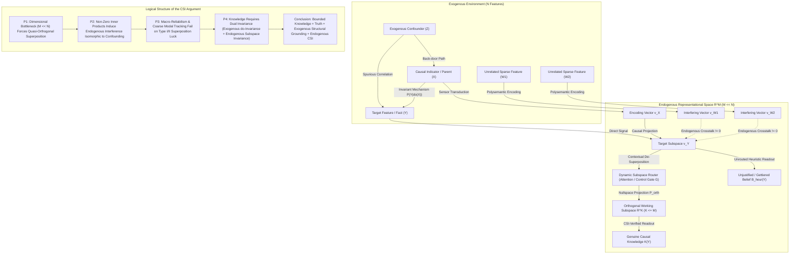

# Epistemic Compression and Counterfactual Subspace Invariance: How Bounded Cognitive Systems Distinguish Causal Knowledge from Superposition Luck

## Abstract

Contemporary epistemology and the philosophy of cognitive science face a shared but largely unintegrated predicament. Post-Gettier epistemology seeks to explain what elevates true belief to genuine knowledge, appealing to causal pathways (Goldman, 1967), modal tracking conditions such as sensitivity and safety (Nozick, 1981; Sosa, 1999; Williamson, 2000), or structural causal models (Pearl, 2009; Woodward, 2003). Implicit in nearly all such accounts is an idealization of *representational separability*: the assumption that an epistemic agent possesses distinct, non-interfering representational coordinates for each causally relevant feature of the environment. Conversely, computational neuroscience and mechanistic interpretability in artificial intelligence demonstrate that bounded physical systems operating in high-dimensional environments must represent $N$ environmental features within an $M$-dimensional representational medium where $M \ll N$. Under this dimensional bottleneck, optimal bounded agents inevitably exploit *superposition*—encoding features as quasi-orthogonal directions in shared activation spaces (Smolensky, 1988; Elhage et al., 2022).

This paper argues that dimensional compression introduces a previously unrecognized species of epistemic luck—*endogenous superposition luck*—that is structurally isomorphic to exogenous causal confounding and generates internal Gettier cases even when the external environment is causally unconfounded. To resolve this dilemma without collapsing into radical skepticism for finite minds, I develop and defend the **Counterfactual Subspace Invariance (CSI)** account of bounded knowledge. According to CSI, a bounded agent knows a proposition $P$ only if its belief-forming readout is counterfactually invariant across both (i) exogenous interventions on Reichenbachian common causes in the external world and (ii) endogenous perturbations within the local interference cone of co-activated features in the agent's representational manifold. I formalize this dual invariance criterion using structural causal models and high-dimensional geometry, demonstrate how it solves the generality problem for bounded reliabilism, and show how cognitive systems employ dynamic subspace routing (attention and cognitive control) to transition from compressed statistical heuristics to genuine causal knowledge.

---

## 1. Introduction: The Idealization of Representational Separability

Since Edmund Gettier's (1963) challenge to the tripartite analysis of knowledge, analytic epistemology has sought a condition that rules out *veritic epistemic luck*—cases where a belief is true and formed via a prima facie reliable procedure, yet its truth is accidental relative to the mechanism of belief formation (Pritchard, 2005). Externalist responses fall into three main families: causal and process-reliabilist theories requiring truth-conducive causal processes (Goldman, 1967, 1979, 1986); modal tracking theories requiring counterfactual sensitivity or safety across nearby worlds (Nozick, 1981; Sosa, 1999; Williamson, 2000); and structural causal theories modeling epistemic grounding via directed acyclic graphs (DAGs) and invariant causal mechanisms (Spirtes, Glymour, & Scheines, 2000; Woodward, 2003; Pearl, 2009; Weisberg, 2011; Fitelson, 2017).

Despite deep disagreements over modal logic, probability, and causation, these frameworks share a tacit architectural assumption: **Representational Separability (RS)**. RS assumes that for any set of distinct environmental features $\{F_1, \dots, F_N\}$ an agent can track, its cognitive architecture assigns them to functionally independent, mutually orthogonal representational coordinates. Under RS, if an agent mistakes correlation for causation or falls victim to a Gettier case (e.g., Chisholm's sheep-in-the-field or Goldman's fake barns), the failure lies either in external causal wiring or explicit inferential error; the representational medium itself is treated as a lossless ledger.

Yet biological brains and artificial neural networks are physically bounded systems subject to severe informational and dimensional bottlenecks (Simon, 1955; Shannon, 1948; Tishby, Pereira, & Bialek, 1999). A cortical region or deep network confronts an environment containing millions of sparse, causally operative features ($N \gg 10^6$), whereas the active neural population or residual stream dimension at any bottleneck is strictly finite ($M \ll N$). Converging results in high-dimensional geometry, computational neuroscience (mixed selectivity in prefrontal cortex; Rigotti et al., 2013), and mechanistic interpretability (Olshausen & Field, 1997; Arora et al., 2018; Elhage et al., 2022) establish that when features are *sparse*, a bounded system maximizes expected epistemic utility not by dedicating one orthogonal dimension to each feature (monosemanticity) and discarding $N - M$ features, but by packing all $N$ features into $\mathbb{R}^M$ as *quasi-orthogonal vectors*—a phenomenon known as **representational superposition**.

When $N > M$, linear algebra guarantees that distinct feature vectors cannot be mutually orthogonal ($\langle \mathbf{v}_i, \mathbf{v}_j \rangle \neq 0$). Consequently, activating one feature projects "phantom" geometric energy—*crosstalk* or *interference*—onto the axes of causally unrelated features. My central thesis is threefold:
1. **Bifurcation of Epistemic Luck**: Dimensional compression forces a trade-off between representational coverage and epistemic safety, generating *endogenous superposition luck*—cases where a belief is true only because internal crosstalk cancels out or mimics a missing external signal. This internal interference is mathematically isomorphic to Reichenbachian causal confounding.
2. **Failure of Coarse Modal and Reliabilist Accounts**: Standard process reliabilism (Goldman, 1979) and modal tracking (Nozick, 1981; Williamson, 2000) cannot diagnose superposition luck because they individuate methods macro-behaviorally, ignoring subspace geometry. Conversely, dismissing all superposed representations as unjustified collapses bounded epistemology into radical skepticism.
3. **Counterfactual Subspace Invariance (CSI)**: Genuine causal knowledge requires that the readout projection for $Y$ remain invariant across both (a) exogenous counterfactual interventions on external confounders (Pearlian $do$-invariance) and (b) endogenous perturbations across the sparse co-activation neighborhood occupying the local interference cone of $Y$ in $\mathbb{R}^M$. When dense co-occurrence or high stakes threaten internal invariance, cognitive systems employ *dynamic subspace routing* (attention heads or frontoparietal control) to project active features into a strictly orthogonal working subspace.

Section 2 formalizes bounded representation and superposition. Section 3 demonstrates the isomorphism between exogenous confounding and endogenous interference, introducing *Endogenous Gettier Cases* and their consequences for Bayesian conditionalization and closure. Section 4 formulates Counterfactual Subspace Invariance (CSI) with an explicit DAG and formal criteria. Section 5 analyzes attention and working memory as dynamic subspace routers. Section 6 replies to four major objections. Section 7 explores implications for AI world models, virtue epistemology, anti-luminosity, and causal decision theory. Section 8 concludes.

---

## 2. The Geometry of Bounded Representation: From Bottlenecks to Superposition

Consider an epistemic agent $\mathcal{A}$ in an environment $\mathcal{E}$ governed by a structural causal model $\mathcal{M}_{\mathcal{E}} = \langle \mathcal{U}, \mathcal{V}, \mathcal{F}, P(\mathcal{U}) \rangle$ (Pearl, 2009), where $\mathcal{V} = \{F_1, \dots, F_N\}$ is a set of $N$ causal features, $\mathcal{U}$ is exogenous noise, and $\mathcal{F}$ consists of structural equations $F_i = f_i(Pa(F_i), U_i)$. At world $w$, the environment instantiates feature vector $\mathbf{x}(w) = [x_1, \dots, x_N]^T \in \mathbb{R}^N$. Natural environments exhibit **feature sparsity**: at any locus $w$, most features are inactive ($P(x_i = 0) \to 1$), so on average only $k \ll N$ features are active ($||\mathbf{x}(w)||_0 \approx k$).

The bounded agent's internal state at a bottleneck is a vector $\mathbf{r} \in \mathbb{R}^M$ ($M \ll N$). In a standard linear-nonlinear encoding architecture (Dayan & Abbott, 2001; Elhage et al., 2022), $\mathcal{A}$ maps $\mathbf{x} \in \mathbb{R}^N$ into $\mathbb{R}^M$ via encoding matrix $\mathbf{W}_{enc} \in \mathbb{R}^{M \times N}$:

$$\mathbf{r} = \mathbf{W}_{enc} \mathbf{x} = \sum_{i=1}^{N} x_i \mathbf{v}_i$$

where $\mathbf{v}_i \in \mathbb{R}^M$ ($||\mathbf{v}_i||_2 = 1$) is the encoding direction for $F_i$. To form a belief about $F_i$, $\mathcal{A}$ applies readout operator $\psi_i: \mathbb{R}^M \to \mathbb{R}$ with activation $\sigma$ (e.g., $\text{ReLU}(z) = \max(0, z)$) and bias $b_i$:

$$\hat{x}_i = \psi_i(\mathbf{r}) = \sigma\left(\langle \mathbf{v}_i, \mathbf{r} \rangle + b_i\right) = \sigma\left(x_i + \sum_{j \neq i} x_j \langle \mathbf{v}_i, \mathbf{v}_j \rangle + b_i\right)$$

This creates a fundamental geometric dilemma:
1. **Orthogonal (Monosemantic) Regime ($N \le M$)**: Assigning at most $M$ features to mutually orthogonal basis vectors ($\langle \mathbf{v}_i, \mathbf{v}_j \rangle = 0$ for $i \neq j$) eliminates interference identically, but inflicts catastrophic **ontological blindness** by discarding $N - M$ features.
2. **Superposed (Polysemantic) Regime ($N > M$)**: By the Johnson-Lindenstrauss lemma (Johnson & Lindenstrauss, 1984), $\mathbb{R}^M$ can pack $N \propto \exp(c \cdot \epsilon^2 M)$ unit vectors with pairwise inner products bounded by $\epsilon$:

$$\forall i \neq j, \quad |\langle \mathbf{v}_i, \mathbf{v}_j \rangle| \le \epsilon$$

Individual coordinates become *polysemantic*, while features are represented as distributed quasi-orthogonal directions (Smolensky, 1988; Olah et al., 2020; Elhage et al., 2022). However, packing $N > M$ vectors into $\mathbb{R}^M$ incurs a strict lower bound on interference via the **Welch Bound** (Welch, 1974):

$$\max_{i \neq j} |\langle \mathbf{v}_i, \mathbf{v}_j \rangle| \ge \sqrt{\frac{N - M}{M(N - 1)}}$$

Consequently, the readout $\hat{x}_i$ is contaminated by the **endogenous interference term**:

$$\mathcal{I}_i(w) \equiv \sum_{j \neq i} x_j(w) \langle \mathbf{v}_i, \mathbf{v}_j \rangle$$

When active features are sparse and $b_i = -\tau$ ($\tau > k \epsilon$), $\sigma$ filters out low-level noise, recovering $\hat{x}_i \approx x_i$ in typical contexts. Yet the agent has traded **structural insulation** for **probabilistic compression**, importing confounding and Gettier luck into its own mind.

---

## 3. The Bifurcation of Epistemic Luck: Exogenous Confounding vs. Endogenous Interference

In causal inference, **spurious correlation via confounding** arises when a common cause $Z$ influences both indicator $X$ and target $Y$ ($X \leftarrow Z \to Y$); relying on $P(Y \mid X)$ without blocking the back-door path through $Z$ mistakes a shadow of $Z$ for causation (Reichenbach, 1956; Pearl, 2009; Spirtes et al., 2000). Similarly, in classic Gettier cases, a disruption breaks or bypasses the normal link between indicator $X$ and target $Y$ while an extraneous factor independently makes $Y$ true (Zagzebski, 1994; Pritchard, 2005; Chisholm, 1966; Goldman, 1976).

Under superposition ($N > M$), the geometry of $\mathbb{R}^M$ generates an internal double of these phenomena even when the external world is unconfounded. Epistemic luck bifurcates into **Exogenous Causal Luck** and **Endogenous Superposition Luck**, yielding three mechanisms of internal failure:

### 3.1 Phantom Confounding (False Positives via Constructive Interference)
Suppose $F_Y$ is absent ($x_Y(w) = 0$), but $m$ sparse, causally unrelated features $\{F_{W_1}, \dots, F_{W_m}\}$ are active ($x_{W_k}(w) > 0$), each with inner product $\langle \mathbf{v}_Y, \mathbf{v}_{W_k} \rangle = +\epsilon$. When $\sum_{k=1}^{m} x_{W_k}(w) \langle \mathbf{v}_Y, \mathbf{v}_{W_k} \rangle > \tau$, the readout $\psi_Y(\mathbf{r})$ fires, producing $B(Y)$ from crosstalk. Non-orthogonality in $\mathbf{W}_{enc}$ acts as a **synthetic common cause** coupling $F_{W_k}$ and $B(Y)$ despite causal independence ($P_{\mathcal{E}}(Y \mid do(W_k)) = P_{\mathcal{E}}(Y)$).

### 3.2 Endogenous Gettier Cases Type I: Veridical Hallucination by Constructive Crosstalk
Suppose $Y$ obtains ($x_Y(w_0) = 1$), but sensor occlusion attenuates the pathway from $Y$ to $\mathbf{r}$ below threshold $\tau$. Simultaneously, unrelated features $F_{W_1}, F_{W_2}$ in the scene share positive inner products with $\mathbf{v}_Y$, and their constructive interference $\mathcal{I}_Y(w_0) = \sum_k x_{W_k} \langle \mathbf{v}_Y, \mathbf{v}_{W_k} \rangle$ pushes $\langle \mathbf{v}_Y, \mathbf{r} \rangle$ above $\tau$, yielding true belief $B(Y)$. Paralleling Chisholm's sheep, $Y$ is true and $\psi_Y$ is globally reliable, but $B(Y)$ is triggered by endogenous crosstalk rather than $Y$.

### 3.3 Endogenous Gettier Cases Type II: Double-Interference Cancellation (Internal Fake Barns)
Suppose the causal channel from $Y$ to $\mathbf{r}$ is intact ($x_Y(w_0) = 1$). However, a strong distractor $F_{D_1}$ with negative overlap $\langle \mathbf{v}_Y, \mathbf{v}_{D_1} \rangle = -\delta$ ($1 - \delta < \tau$) is active, which would normally blind the agent to $Y$. Coincidentally, a second unrelated feature $F_{D_2}$ is active with $\langle \mathbf{v}_Y, \mathbf{v}_{D_2} \rangle = +\delta$, so the interference terms cancel exactly:

$$\mathcal{I}_Y(w_0) = x_{D_1} \langle \mathbf{v}_Y, \mathbf{v}_{D_1} \rangle + x_{D_2} \langle \mathbf{v}_Y, \mathbf{v}_{D_2} \rangle = -\delta + \delta = 0$$

Consequently, $\langle \mathbf{v}_Y, \mathbf{r} \rangle = x_Y(w_0) = 1 > \tau$, and the agent forms true belief $B(Y)$ caused by $x_Y(w_0)$. Type II cases defeat both simple causal theories (Goldman, 1967) and Nozickian sensitivity (Nozick, 1981):
- **Intact Causal Chain**: $x_Y(w_0)$ genuinely causes $\mathbf{v}_Y$ activation and $B(Y)$.
- **Nozickian Sensitivity Satisfied**: In the nearest world $w'$ where $Y$ is false ($x_Y(w') = 0$) holding $D_1, D_2$ fixed, interference still cancels to $0$, so $\langle \mathbf{v}_Y, \mathbf{r}(w') \rangle = 0 < \tau$ and $\mathcal{A}$ does not believe $Y$.
- **Modal Fragility (Internal Fake Barn County)**: In any nearby world where $D_2$ fluctuates without $D_1$, destructive interference $-\delta$ swamps the readout.

### 3.4 Formal Epistemological Consequences: Screening-Off Violations and Closure Breakdown
Superposition also illuminates formal puzzles in Bayesian conditionalization (Weisberg, 2011) and deductive closure (Fitelson, 2017; Nozick, 1981). Parameterizing credences via $Cr(F_i) = \sigma(\langle \mathbf{v}_i, \mathbf{r} \rangle + b_i)$ in $\mathbb{R}^M$ ($M \ll N$) induces two anomalies:
1. **Violation of Screening-Off**: Conditioning on $Pa(Y)$ in $\mathbb{R}^M$ imports crosstalk $\langle \mathbf{v}_{Pa(Y)}, \mathbf{v}_W \rangle$, violating $P(Y \mid Pa(Y), W) = P(Y \mid Pa(Y))$, while subtracting noisy estimates $\hat{x}_W \mathbf{v}_W$ induces internal collider bias.
2. **Deductive Closure Breakdown**: Fitelson (2017) shows how tracking and threshold rules fail closure. Mechanistically, even if $P$ entails $Q$ and $B(P)$ has margin $\Delta > \sup |\mathcal{I}_P|$, mapping $\mathbf{v}_P \mapsto \mathbf{v}_Q$ via $\mathbf{W}_{PQ}$ exposes $B(Q)$ to the interference cone $\mathcal{C}(Q)$, which can breach $\Delta$ and destroy safety across single-step deduction.

---

## 4. The Counterfactual Subspace Invariance (CSI) Account of Bounded Knowledge

To diagnose both exogenous confounding and endogenous superposition luck within a unified framework, I now formulate the **Counterfactual Subspace Invariance (CSI)** theory of knowledge.

### 4.1 Explicit Structural Mapping: The Dual Causal-Representational DAG

Figure 1 maps both the exogenous environmental pathways ($\mathcal{E}$) and the endogenous representational pathways ($\mathcal{R}$) terminating in $B(Y)$, alongside the deductive structure of the CSI argument.

### 4.2 Formal Premises and Definitions of the CSI Account

The deductive core of CSI rests on four explicit premises and three formal definitions:

* **Premise 1 (Dimensionality-Sparsity Compression Law)**: Any physical agent $\mathcal{A}$ in an environment $\mathcal{E}$ with $N$ sparse causal features ($N \gg M = \dim(\mathcal{R})$) that avoids ontological blindness ($N_{rep} > M$) must encode features via a frame $\Phi = \{\mathbf{v}_1, \dots, \mathbf{v}_{N_{rep}}\} \subset \mathbb{R}^M$ with non-zero coherence $\mu(\Phi) = \max_{i \neq j} |\langle \mathbf{v}_i, \mathbf{v}_j \rangle| > 0$.
* **Premise 2 (Structural Isomorphism of Confounding and Crosstalk)**: In a linear-nonlinear readout $\hat{x}_Y = \sigma(\langle \mathbf{v}_Y, \mathbf{r} \rangle + b_Y)$, the interference term $\mathcal{I}_Y = \sum_{j \neq Y} x_j \langle \mathbf{v}_Y, \mathbf{v}_j \rangle$ is structurally identical to a sum of unblocked back-door paths $Y \leftarrow \mathbf{W}_{enc} \leftarrow F_j$ in the combined causal graph $\mathcal{M}_{\mathcal{E} \cup \mathcal{R}}$.
* **Premise 3 (Insufficiency of Coarse-Grained Modal and Causal Conditions)**: A belief $B(Y)$ formed via $\hat{x}_Y$ can be true in $w_0$, caused by $x_Y(w_0)$, sensitive to $x_Y$ holding background features fixed, and globally reliable across $P(\mathbf{x})$, while remaining veritically lucky due to Type I or Type II endogenous superposition luck.
* **Premise 4 (Necessity of Dual Counterfactual Invariance)**: Eliminating both exogenous and endogenous veritic luck requires invariance across counterfactual interventions on both external confounders and internal interfering feature coordinates.

#### Definition 1: The Local Interference Cone ($\mathcal{C}(Y)$)
For target feature $F_Y$ with encoding vector $\mathbf{v}_Y \in \mathbb{R}^M$ and threshold $\tau > 0$, the *Local Interference Cone* is the set of non-ancestral environmental features $F_j \notin Anc(Y) \cup \{Y\}$ with non-zero projection onto $\mathbf{v}_Y$:

$$\mathcal{C}(Y) = \left\{ F_j \in \mathcal{V} \setminus (Anc(Y) \cup \{Y\}) \;\middle|\; |\langle \mathbf{v}_Y, \mathbf{v}_j \rangle| > 0 \right\}$$

#### Definition 2: Sparsity-Indexed Modal Neighborhood ($\mathcal{N}_{\rho}(w_0)$)
Given actual world $w_0$ with active feature vector $\mathbf{x}(w_0)$, the *Sparsity-Indexed Modal Neighborhood* $\mathcal{N}_{\rho}(w_0)$ of radius $\rho$ consists of all causally accessible worlds $w'$ obtained by local interventions $do(\mathbf{x}_S = \mathbf{x}'_S)$ on subsets $S \subseteq \mathcal{V}$ such that:
1. $||\mathbf{x}(w') - \mathbf{x}(w_0)||_0 \le k_{\max}$ (the characteristic environmental sparsity bound at confidence $1 - \delta_{env}$); and
2. $P_{\mathcal{E}}(\mathbf{x}(w')) \ge \rho$, restricting evaluation to ecologically realizable sparse worlds rather than Cartesian demon worlds where all $N$ features fire simultaneously.

#### Definition 3: Counterfactual Subspace Invariance (CSI)
A bounded agent $\mathcal{A}$ with state $\mathbf{r}(w_0) \in \mathbb{R}^M$ and readout $\psi_Y(\mathbf{r}) = \mathbb{I}[\langle \mathbf{u}_Y, \mathbf{r} \rangle + b_Y > 0]$ possesses **Counterfactual Subspace Invariance** with respect to $Y = y_0 \in \{0, 1\}$ at $w_0$ iff three conditions hold:

1. **Exogenous Causal Grounding (Pearlian Back-Door Invariance)**: Let $X \subseteq Anc(Y)$ be the external indicators transduced in forming $\mathbf{r}(w_0)$, and $Z$ be all exogenous confounders of $X$ and $Y$. Across all counterfactual interventions $do(Z = z)$ in $\mathcal{N}_{\rho}(w_0)$:

   $$P_{\mathcal{M}_{\mathcal{E}}}\left(Y = y_0 \;\middle|\; do(X = x(w_0)), do(Z = z)\right) = P_{\mathcal{M}_{\mathcal{E}}}\left(Y = y_0 \;\middle|\; do(X = x(w_0))\right) \ge 1 - \alpha$$

2. **Endogenous Subspace Insulation (Perturbation Invariance across $\mathcal{C}(Y)$)**: For all counterfactual perturbations $do(\mathbf{x}_{\mathcal{C}(Y)} = \mathbf{x}'_{\mathcal{C}(Y)})$ within $\mathcal{N}_{\rho}(w_0)$ holding $X(w_0)$ and $Y(w_0)$ fixed:

   $$\psi_Y\left(\mathbf{r}\big(do(\mathbf{x}_{\mathcal{C}(Y)} = \mathbf{x}'_{\mathcal{C}(Y)})\big)\right) = \psi_Y\big(\mathbf{r}(w_0)\big) = y_0$$

   Equivalently, the worst-case endogenous crosstalk across $\mathcal{N}_{\rho}(w_0)$ is strictly bounded by the agent's readout margin:

   $$\sup_{w' \in \mathcal{N}_{\rho}(w_0)} \left| \sum_{F_j \in \mathcal{C}(Y)} x_j(w') \langle \mathbf{u}_Y, \mathbf{v}_j \rangle \right| < \big| \langle \mathbf{u}_Y, \mathbf{v}_Y \rangle x_Y(w_0) + b_Y \big|$$

3. **Causal-Geometric Differential Sensitivity**: Under the counterfactual intervention $do(Y = 1 - y_0)$ (producing the nearest world $w^* \in \mathcal{N}_{\rho}(w_0)$ where $Y$ takes the opposite truth value), for all $\mathbf{x}'_{\mathcal{C}(Y)}$ in $\mathcal{N}_{\rho}(w^*)$:

   $$\psi_Y\left(\mathbf{r}\big(do(Y = 1 - y_0), do(\mathbf{x}_{\mathcal{C}(Y)} = \mathbf{x}'_{\mathcal{C}(Y)})\big)\right) = 1 - y_0$$

### 4.3 How CSI Resolves Classical and Endogenous Gettier Cases

1. **Classical Exogenous Gettier Cases**: In Chisholm's sheep, removing the hidden sheep ($do(Y = 0)$) leaves $\mathbf{r}$ unchanged, violating Condition 3, while intervening on the dog-disguise breaks Condition 1. In Fake Barn County, shifting location $Z$ within $\mathcal{N}_{\rho}(w_0)$ places Henry before a facade where $X=1$ but $Y=0$, violating Condition 1.
2. **Type I Endogenous Gettier (Constructive Crosstalk)**: When $Y=1$ is attenuated below threshold and constructive crosstalk from $W_1, W_2 \in \mathcal{C}(Y)$ pushes $\psi_Y$ above zero, perturbing $do(x_{W_1} = 0, x_{W_2} = 0)$ in $\mathcal{N}_{\rho}(w_0)$ while holding $Y=1$ fixed flips $\psi_Y$ from $1$ to $0$, violating Condition 2.
3. **Type II Endogenous Gettier (Double-Interference Cancellation)**: When $D_1, D_2 \in \mathcal{C}(Y)$ cancel out ($-\delta + \delta = 0$), the perturbation $do(x_{D_2} = 0)$ in $\mathcal{N}_{\rho}(w_0)$ leaves $-\delta$ uncompensated, flipping $\psi_Y$ to $0$ and violating Condition 2 ($\sup |\mathcal{I}_Y(w')| = \delta > |\langle \mathbf{u}_Y, \mathbf{v}_Y \rangle + b_Y|$).

---

## 5. Dynamic Subspace Routing: How Bounded Minds Achieve Causal Knowledge

If a bounded agent packs $N \gg M$ features into $\mathbb{R}^M$ with $|\langle \mathbf{v}_i, \mathbf{v}_j \rangle| \le \epsilon$, how can it satisfy Condition 2 of CSI when strong distractors co-occur or when multi-step causal inferences compound $\epsilon$-interference across layers? Here CSI yields a major insight into cognitive architecture: **the primary epistemic function of selective attention and working memory is Dynamic Subspace Routing (contextual de-superposition)**.

### 5.1 From Passive Readout to Active Nullspace Projection
Suppose alongside $F_Y$, a subset of active distractors $\{F_{D_1}, \dots, F_{D_m}\} \subset \mathcal{C}(Y)$ is present in $w_0$. Even though $\langle \mathbf{v}_Y, \mathbf{v}_{D_k} \rangle \neq 0$, so long as the number of *currently active* features satisfies $m + 1 \le M$, the vectors $\{\mathbf{v}_Y, \mathbf{v}_{D_1}, \dots, \mathbf{v}_{D_m}\}$ are **linearly independent**. Thus, there exists an orthogonal projection operator $\mathbf{P}_{\perp D} \in \mathbb{R}^{M \times M}$ onto the nullspace of the active distractor subspace $\mathcal{D}_{act} = \text{span}(\mathbf{v}_{D_1}, \dots, \mathbf{v}_{D_m})$:

$$\mathbf{P}_{\perp D} = \mathbf{I}_M - \mathbf{V}_D (\mathbf{V}_D^T \mathbf{V}_D)^{-1} \mathbf{V}_D^T$$

where $\mathbf{V}_D = [\mathbf{v}_{D_1}, \dots, \mathbf{v}_{D_m}] \in \mathbb{R}^{M \times m}$. Routing the readout through this contextual projection—setting $\mathbf{u}_Y^{ctx} = \frac{\mathbf{P}_{\perp D} \mathbf{v}_Y}{||\mathbf{P}_{\perp D} \mathbf{v}_Y||_2}$—yields:

$$\forall k \in \{1, \dots, m\}, \quad \langle \mathbf{u}_Y^{ctx}, \mathbf{v}_{D_k} \rangle = \frac{\mathbf{v}_Y^T \mathbf{P}_{\perp D}^T \mathbf{v}_{D_k}}{||\mathbf{P}_{\perp D} \mathbf{v}_Y||_2} = 0$$

By applying $\mathbf{P}_{\perp D}$, the agent **dynamically orthogonalizes** the active subspace, annihilating endogenous crosstalk ($\mathcal{I}_Y^{act} = 0$) and restoring Counterfactual Subspace Invariance.

### 5.2 Biological Dual-Process Theory and Transformer Attention as Epistemic Gatekeepers
This mechanism unifies two major empirical paradigms under an epistemological banner:
1. **Cognitive Control and Working Memory in Humans (Dehaene & Naccache, 2001; Kahneman, 2011; Baddeley, 2003)**: Why is human "System 2" working memory severely capacity-limited ($K \approx 4$ items; Cowan, 2001) compared to vast "System 1" cortical storage? CSI reveals that **working memory capacity is small precisely so that it can be strictly orthogonal**. Unconscious cortical reservoirs operate in dense superposition ($N \gg M$), achieving broad coverage at the cost of crosstalk. Executive attention extracts $K \le M_{WM}$ task-relevant features and projects them into a mutually orthogonal subspace in prefrontal cortex (Rigotti et al., 2013; Panichello & Buschman, 2021) where multi-step causal $do$-simulations can execute without interference.
2. **Self-Attention and Chain-of-Thought in Transformers (Vaswani et al., 2017; Elhage et al., 2021)**: In large language models (LLMs), feed-forward MLP layers store millions of facts in superposition within a residual stream of dimension $M \sim 10^3 - 10^4$ (Geva et al., 2021; Meng et al., 2022). Fast, single-pass MLP lookups under high polysemantic interference violate CSI Condition 2, producing confabulation and prompt brittleness. By contrast, **attention heads** ($\text{Attention}(Q, K, V) = \text{softmax}(\frac{QK^T}{\sqrt{d_k}})V$) dynamically route selected token features into dedicated low-rank orthogonal subspaces, while *Chain-of-Thought (CoT)* externalization exports intermediate states into orthogonal token positions.

Table 1 summarizes these three epistemic regimes:

| Epistemic Regime | Geometric Structure | Vulnerability to Exogenous Confounding | Vulnerability to Endogenous Crosstalk | Epistemic Status under CSI |
| :--- | :--- | :--- | :--- | :--- |
| **Naive Observational Lookup** | Superposed ($N \gg M$), unrouted readout $\mathbf{u}_Y = \mathbf{v}_Y$ | High (tracks $P(Y \mid X)$, blind to confounders $Z$) | High (vulnerable to Type I & II superposition luck) | **Mere Statistical Heuristic** (fails CSI Conditions 1 & 2) |
| **Passive Sparse Superposition** | Superposed ($N \gg M$), thresholded readout $\tau > k\epsilon$ | Moderate (depends on causal training structure) | Low *only* when local sparsity $||\mathbf{x}||_0 \le k$ holds | **Bounded Defeasible Knowledge** (satisfies CSI locally in $\mathcal{N}_{\rho}(w_0)$) |
| **Dynamic Subspace Routing (Attention / System 2)** | Contextual nullspace projection $\mathbf{P}_{\perp D}$ into orthogonal $\mathbb{R}^K$ | Low (enables explicit conditioning & $do$-simulation) | Zero across attended distractors ($\langle \mathbf{u}_Y^{ctx}, \mathbf{v}_{D_k} \rangle = 0$) | **Robust Causal Knowledge** (satisfies CSI Conditions 1, 2, & 3 globally) |

---

## 6. Objections and Replies

I now test the Counterfactual Subspace Invariance account against four major objections from analytic epistemology, formal learning theory, and philosophy of neuroscience.

### 6.1 Objection 1: The Ultra-Skepticism Objection (The Welch Bound Dilemma)
**Objection**: "By Premise 1 and the Welch bound, any bounded system with $N > M$ has non-zero inner products $|\langle \mathbf{v}_i, \mathbf{v}_j \rangle| > 0$, and dynamic routing ($\mathbf{P}_{\perp D}$) can orthogonalize at most $m < M$ distractors, leaving $N - M$ unattended features in $\mathcal{C}(Y)$. Thus, there always exist possible worlds $w'$ where enough unattended features co-occur to overwhelm $\tau$. Doesn't CSI entail that bounded agents can *never* have knowledge when $N > M$, collapsing into Cartesian skepticism?"

**Reply**: This objection conflates *global logical invariance across all vectors in $\mathbb{R}^N$* with *sparsity-indexed modal invariance across $\mathcal{N}_{\rho}(w_0)$*. Definition 2 and Condition 2 do not quantify over dense "demon worlds" where $10^5$ rare features fire simultaneously with adversarial signs; they quantify over the **Sparsity-Indexed Modal Neighborhood $\mathcal{N}_{\rho}(w_0)$**, bounded by ecological sparsity $||\mathbf{x}(w') - \mathbf{x}(w_0)||_0 \le k_{\max}$ and density $P_{\mathcal{E}}(\mathbf{x}(w')) \ge \rho$. By Candès, Romberg, and Tao's (2006) **$(k, \delta)$-Restricted Isometry Property (RIP)** in compressed sensing, a quasi-orthogonal frame $\Phi \in \mathbb{R}^{M \times N}$ with $N \gg M$ acts as an almost-orthogonal isometry on *every* sparse subset $S$ of size $|S| \le k_{\max}$:

$$(1 - \delta_k) ||\mathbf{x}_S||_2^2 \le ||\Phi_S \mathbf{x}_S||_2^2 \le (1 + \delta_k) ||\mathbf{x}_S||_2^2$$

When $\delta_k$ is small and the readout margin exceeds $k_{\max} \epsilon$, $\psi_Y(\mathbf{r})$ is **provably invariant** across every world in $\mathcal{N}_{\rho}(w_0)$. When a local context contains strong distractors that would breach the passive RIP margin, dynamic routing ($\mathbf{P}_{\perp D}$) projects them out, restoring the residual perturbation to the safe RIP regime.

### 6.2 Objection 2: The Generality Problem Relocated (Conee & Feldman, 1998)
**Objection**: "Process reliabilism (Goldman, 1979) suffers from the *Generality Problem* (Conee & Feldman, 1998; Bishop, 2010): any token process instantiates infinitely many types with different reliabilities. Doesn't CSI merely relocate the generality problem into linear algebra and the choice of neighborhood radius $\rho$?"

**Reply**: CSI provides the missing **mechanistic-geometric solution** to the Generality Problem. Classical reliabilism relies on folk-psychological descriptions ("vision," "memory") that fail to carve cognitive architecture at its joints. Under CSI, a token belief $B(Y)$ is produced by a physical mechanism with an objective mathematical tuple:

$$\mathcal{P}_Y = \langle \mathbf{W}_{enc}, \mathbf{u}_Y^{ctx}, b_Y, \sigma \rangle$$

This tuple uniquely and objectively fixes the Local Interference Cone $\mathcal{C}(Y)$ via the non-zero entries of $\mathbf{u}_Y^{ctx\,T} \mathbf{W}_{enc}$ modulo $Anc(Y)$ in $\mathcal{M}_{\mathcal{E}}$. Moreover, while $\rho$ and $k_{\max}$ are calibrated by ecological tail bounds (or practical stakes; Stanley, 2005), the *structural ordering* of epistemic robustness is invariant: any belief whose margin $|\langle \mathbf{u}_Y, \mathbf{v}_Y \rangle x_Y + b_Y|$ is smaller than actual interference $|\mathcal{I}_Y(w_0)|$ (as in Type I and II Endogenous Gettier cases) violates Condition 2 for *every* non-trivial neighborhood containing single-feature deletions $do(x_{D_k} = 0)$.

### 6.3 Objection 3: The Nonlinear Manifold Objection
**Objection**: "CSI is formulated using linear projections $\langle \mathbf{u}_Y, \mathbf{r} \rangle$ and flat subspaces in $\mathbb{R}^M$. Yet biological brains and deep networks are highly nonlinear and may encode features as curved manifolds or limit cycles. Does CSI fail outside the linear representation hypothesis?"

**Reply**: The linear algebra of Sections 2–5 is the tangent-space realization of a general **differential-geometric formulation of CSI** on smooth Riemannian manifolds. Let the representational space be an $M$-dimensional Riemannian manifold $(\mathcal{M}_R, g)$ with smooth encoding map $\Phi: \mathbb{R}^N \to \mathcal{M}_R$ and readout function $\Psi_Y: \mathcal{M}_R \to \mathbb{R}$. Each feature $F_j$ induces a pushforward vector field on $\mathcal{M}_R$:

$$\mathcal{V}_j(\mathbf{r}) = d\Phi_{\mathbf{x}}\left(\frac{\partial}{\partial x_j}\right) \in T_{\mathbf{r}}\mathcal{M}_R \cong \mathbb{R}^M$$

Because $\dim(T_{\mathbf{r}}\mathcal{M}_R) = M \ll N$ (and by Brouwer's Invariance of Domain theorem, $\mathbb{R}^N$ cannot be stably embedded into $\mathcal{M}_R$ without dimension-reducing projection), the $N$ vector fields $\{\mathcal{V}_1(\mathbf{r}), \dots, \mathcal{V}_N(\mathbf{r})\}$ must be non-orthogonal with respect to $g_{\mathbf{r}}$. Condition 2 of CSI generalizes directly to requiring that the **Lie derivative** of $\Psi_Y$ along any non-ancestral vector field $\mathcal{V}_j \in \mathcal{C}(Y)$ remain bounded below the threshold margin across $\mathcal{N}_{\rho}(w_0)$:

$$\forall F_j \in \mathcal{C}(Y), \quad \big| (\mathcal{L}_{\mathcal{V}_j} \Psi_Y)(\mathbf{r}) \big| = \big| d\Psi_Y(\mathcal{V}_j(\mathbf{r})) \big| \ll |\Psi_Y(\mathbf{r}_0)|$$

while dynamic routing ($\mathbf{P}_{\perp D}$) aligns the cotangent 1-form $d\Psi_Y \in T^*_{\mathbf{r}}\mathcal{M}_R$ to annihilate active distractor vector fields.

### 6.4 Objection 4: The Internalist/Externalist Dilemma and Epistemic Bootstrapping
**Objection**: "If CSI is externalist, how does the agent know *when* to trigger Dynamic Subspace Routing ($\mathbf{P}_{\perp D}$) without already knowing which distractors $D_1, \dots, D_m$ are active? Conversely, if the agent must first read out $D_1, \dots, D_m$ from the superposed vector $\mathbf{r}$ to project them out, doesn't that launch a vicious infinite regress?"

**Reply**: First, CSI is an **architectural-externalist** condition on first-order knowledge: $\psi_Y(\mathbf{r})$ must *in fact* satisfy Conditions 1–3, without requiring a second-order belief $B(\text{CSI}(Y))$. Second, triggering $\mathbf{P}_{\perp D}$ does not require homuncular prior knowledge of distractors; in compressed sensing and cortical circuitry, it is achieved by **Iterative Soft-Thresholding and Explaining-Away Dynamics** (Olshausen & Field, 1997; Candès et al., 2006). At $t=0$, the system detects polysemantic collision via global energy dispersion (e.g., the $L_1/L_2$ norm ratio of projections, mediated in humans by anterior cingulate conflict monitoring; Botvinick et al., 2001). Recurrent lateral inhibition or stacked attention layers then iteratively subtract out dominant projections ($\mathbf{r}^{(t+1)} = \mathbf{r}^{(t)} - \eta \mathbf{W}_{enc} \sigma(\mathbf{W}_{enc}^T \mathbf{r}^{(t)} - \tau)$), converging physically to the unique sparse vector $\hat{\mathbf{x}}$ whenever $(k, \delta)$-RIP holds.

---

## 7. Implications for Epistemology and the Philosophy of AI

### 7.1 Resolving the Debate Over Whether LLMs Have "World Models" or "Mere Statistics"
Philosophers and AI researchers sharply debate whether large neural networks possess genuine world models (Li et al., 2023; Gurnee & Tegmark, 2023) or are merely "stochastic parrots" (Bender et al., 2021; Marcus, 2020). CSI shows why treating an AI model monolithically is a category mistake. Within the *same* network, representations lie along a geometric spectrum of subspace invariance: tail-distribution facts stored in high-interference MLP superposition violate CSI Condition 2 (yielding prompt brittleness and Type I/II superposition luck), whereas core structural domains equipped with low-coherence subspaces and routing attention heads ($\mathbf{P}_{\perp D}$) genuinely satisfy CSI. Moreover, CSI reveals that **mechanistic interpretability**—using sparse autoencoders (SAEs) and activation patching ($do(\mathbf{r})$) to measure $\langle \mathbf{u}_Y, \mathbf{v}_j \rangle$—is literally *applied formal epistemology* for artificial minds.

### 7.2 Epistemic Virtue as Geometric Hygiene and the Failure of the KK Principle
In virtue epistemology (Sosa, 2007; Greco, 2010; Zagzebski, 1996), knowledge is true belief manifesting intellectual competence. Under CSI, epistemic virtue in bounded agents consists in **geometric hygiene and metacognitive routing**: calibrating $\mathbf{W}_{enc}$ to environmental sparsity, monitoring internal crosstalk entropy, and triggering deliberative System 2 nullspace projection ($\mathbf{P}_{\perp D}$) when interference threatens safety margins. Furthermore, CSI provides an independent mathematical proof of Williamson's (2000) **Anti-Luminosity Argument** and the failure of the **KK Principle** ($K(Y) \Rightarrow K(K(Y))$): in a superposed mind, forming a higher-order representation $B(K(Y))$ requires an additional readout projection that compounds frame coherence error $\epsilon$, widening the interference cone $\mathcal{C}(K(Y)) \supset \mathcal{C}(Y)$ and eroding the margin for error.

### 7.3 Unifying Causal Decision Theory and Bounded Epistemology
In causal decision theory (Joyce, 1999; Pearl, 2009), rational action requires evaluating interventional expectations $P(O \mid do(A))$ rather than evidential conditionals $P(O \mid A)$. CSI demonstrates that **internal representational interference acts as an evidential confounder inside the decision-maker's mind**: if an agent evaluates action $A$ using an unrouted representation $\mathbf{r}$, an unrelated feature $F_W$ sharing positive crosstalk with outcome vector $\mathbf{v}_O$ will make $A$ appear causally efficacious when it is not. Projecting the decision-relevant causal graph into an orthogonal working subspace via CSI is therefore a precondition for rational agency.

---

## 8. Conclusion

Epistemology can no longer idealize the mind as an infinite-dimensional, orthogonal ledger. Every finite physical knower—biological or artificial—confronts an environment whose causal richness ($N$) vastly exceeds the dimensionality of its active representational bottleneck ($M$). To avoid catastrophic ontological blindness, bounded minds must compress reality via *representational superposition*, encoding features along quasi-orthogonal directions that inevitably share non-zero overlap.

This dimensional compression introduces *endogenous superposition luck*, which is mathematically isomorphic to exogenous Reichenbachian confounding and generates Type I and Type II Endogenous Gettier cases even when external causal channels are intact. By requiring that a belief's readout projection remain invariant across both exogenous $do$-interventions on environmental confounders and endogenous perturbations across the local interference cone within the sparsity-indexed modal neighborhood, **Counterfactual Subspace Invariance (CSI)** filters out both classical and internal Gettier luck, while explaining how selective attention and working memory dynamically orthogonalize representations to achieve genuine causal knowledge.

---

## References

* Arora, S., Li, Y., Liang, Y., Ma, T., & Risteski, A. (2018). Linear algebraic structure of word senses, with applications to polysemy. *Transactions of the Association for Computational Linguistics*, 6, 483–495.
* Baddeley, A. (2003). Working memory: Looking back and looking forward. *Nature Reviews Neuroscience*, 4(10), 829–839.
* Bender, E. M., Gebru, T., McMillan-Major, A., & Shmitchell, S. (2021). On the dangers of stochastic parrots: Can language models be too big? *Proceedings of the 2021 ACM Conference on Fairness, Accountability, and Transparency*, 610–623.
* Bishop, M. A. (2010). Why the generality problem is everybody's problem. *Philosophical Studies*, 151(2), 285–298.
* Botvinick, M. M., Braver, T. S., Barch, D. M., Carter, C. S., & Cohen, J. D. (2001). Conflict monitoring and cognitive control. *Psychological Review*, 108(3), 624–652.
* Candès, E. J., Romberg, J. K., & Tao, T. (2006). Stable signal recovery from incomplete and inaccurate measurements. *Communications on Pure and Applied Mathematics*, 59(8), 1207–1223.
* Chisholm, R. M. (1966). *Theory of knowledge*. Prentice-Hall.
* Conee, E., & Feldman, R. (1998). The generality problem for reliabilism. *Philosophical Studies*, 89(1), 1–29.
* Cowan, N. (2001). The magical number 4 in short-term memory: A reconsideration of mental storage capacity. *Behavioral and Brain Sciences*, 24(1), 87–114.
* Dayan, P., & Abbott, L. F. (2001). *Theoretical neuroscience: Computational and mathematical modeling of neural systems*. MIT Press.
* Dehaene, S., & Naccache, L. (2001). Towards a cognitive neuroscience of consciousness: Basic evidence and a workspace framework. *Cognition*, 79(1–2), 1–37.
* Elhage, N., Nanda, N., Olsson, C., Henighan, T., Joseph, N., Mann, B., ... & Olah, C. (2021). A mathematical framework for transformer circuits. *Transformer Circuits Thread*.
* Elhage, N., Hume, T., Olsson, C., Schiefer, N., Henighan, T., Kravec, S., ... & Olah, C. (2022). Toy models of superposition. *Transformer Circuits Thread*.
* Fantl, J., & McGrath, M. (2002). Evidence, pragmatics, and justification. *The Philosophical Review*, 111(1), 67–94.
* Fitelson, B. (2017). Closure, counterexamples, and causal decision theory. *Philosophical Studies*, 174(7), 1669–1685.
* Gettier, E. L. (1963). Is justified true belief knowledge? *Analysis*, 23(6), 121–123.
* Geva, M., Schuster, R., Berant, J., & Levy, O. (2021). Transformer feed-forward layers are key-value memories. *Proceedings of the 2021 Conference on Empirical Methods in Natural Language Processing*, 5484–5495.
* Goldman, A. I. (1967). A causal theory of knowing. *The Journal of Philosophy*, 64(12), 357–372.
* Goldman, A. I. (1976). Discrimination and perceptual knowledge. *The Journal of Philosophy*, 73(20), 771–791.
* Goldman, A. I. (1979). What is justified belief? In G. S. Pappas (Ed.), *Justification and knowledge* (pp. 1–23). D. Reidel.
* Goldman, A. I. (1986). *Epistemology and cognition*. Harvard University Press.
* Greco, J. (2010). *Achieving knowledge: A virtue-theoretic account of epistemic normativity*. Cambridge University Press.
* Gurnee, W., & Tegmark, M. (2023). Language models represent space and time. *arXiv preprint arXiv:2310.02207*.
* Henderson, D., & Horgan, T. (2006). Transglobal reliabilism. *Croatian Journal of Philosophy*, 6(17), 171–195.
* Johnson, W. B., & Lindenstrauss, J. (1984). Extensions of Lipschitz mappings into a Hilbert space. *Contemporary Mathematics*, 26, 189–206.
* Joyce, J. M. (1999). *The foundations of causal decision theory*. Cambridge University Press.
* Kahneman, D. (2011). *Thinking, fast and slow*. Farrar, Straus and Giroux.
* Li, K., Hopkins, A. K., Bau, D., Viégas, F., Pfister, H., & Wattenberg, M. (2023). Emergent world representations: Exploring a sequence model trained on a synthetic task. *International Conference on Learning Representations (ICLR)*.
* Marcus, G. (2020). The next decade in AI: Four steps towards robust artificial intelligence. *arXiv preprint arXiv:2002.06177*.
* Meng, K., Bau, D., Andonian, A., & Belinkov, Y. (2022). Locating and editing factual associations in GPT. *Advances in Neural Information Processing Systems*, 35, 17359–17372.
* Nozick, R. (1981). *Philosophical explanations*. Harvard University Press.
* Olah, C., Cammarata, N., Schubert, L., Goh, G., Petrov, M., & Carter, S. (2020). Zoom in: An introduction to circuits. *Distill*, 5(3), e00024-001.
* Olshausen, B. A., & Field, D. J. (1997). Sparse coding with an overcomplete basis set: A strategy employed by V1? *Vision Research*, 37(23), 3311–3325.
* Panichello, M. F., & Buschman, T. J. (2021). Shared mechanisms underlie the control of working memory and attention. *Nature*, 592(7855), 601–605.
* Pearl, J. (2009). *Causality: Models, reasoning, and inference* (2nd ed.). Cambridge University Press.
* Pritchard, D. (2005). *Epistemic luck*. Oxford University Press.
* Reichenbach, H. (1956). *The direction of time*. University of California Press.
* Rigotti, M., Barak, O., Warden, M. R., Wang, X. J., Daw, N. D., Miller, E. K., & Fusi, S. (2013). The importance of mixed selectivity in complex cognitive tasks. *Nature*, 497(7451), 585–590.
* Shannon, C. E. (1948). A mathematical theory of communication. *The Bell System Technical Journal*, 27(3), 379–423.
* Simon, H. A. (1955). A behavioral model of rational choice. *The Quarterly Journal of Economics*, 69(1), 99–118.
* Smolensky, P. (1988). On the proper treatment of connectionism. *Behavioral and Brain Sciences*, 11(1), 1–23.
* Sosa, E. (1999). How to defeat opposition to Moore. *Philosophical Perspectives*, 13, 141–153.
* Sosa, E. (2007). *A virtue epistemology: Apt belief and reflective knowledge* (Vol. 1). Oxford University Press.
* Spirtes, P., Glymour, C. N., & Scheines, R. (2000). *Causation, prediction, and search* (2nd ed.). MIT Press.
* Stanley, J. (2005). *Knowledge and practical interests*. Oxford University Press.
* Tishby, N., Pereira, F. C., & Bialek, W. (1999). The information bottleneck method. *Proceedings of the 37th Annual Allerton Conference on Communication, Control, and Computing*, 368–377.
* Vaswani, A., Shazeer, N., Parmar, N., Uszkoreit, J., Jones, L., Gomez, A. N., ... & Polosukhin, I. (2017). Attention is all you need. *Advances in Neural Information Processing Systems*, 30.
* Weisberg, J. (2011). Varieties of Bayesianism. In D. M. Gabbay, S. Hartmann, & J. Woods (Eds.), *Handbook of the history of logic: Vol. 10. Inductive logic* (pp. 477–551). Elsevier.
* Welch, L. (1974). Lower bounds on the maximum cross correlation of signals. *IEEE Transactions on Information Theory*, 20(3), 397–399.
* Williamson, T. (2000). *Knowledge and its limits*. Oxford University Press.
* Woodward, J. (2003). *Making things happen: A theory of causal explanation*. Oxford University Press.
* Zagzebski, L. (1994). The inescapability of Gettier problems. *The Philosophical Quarterly*, 44(174), 65–73.
* Zagzebski, L. (1996). *Virtues of the mind: An inquiry into the nature of virtue and the ethical foundations of knowledge*. Cambridge University Press.
