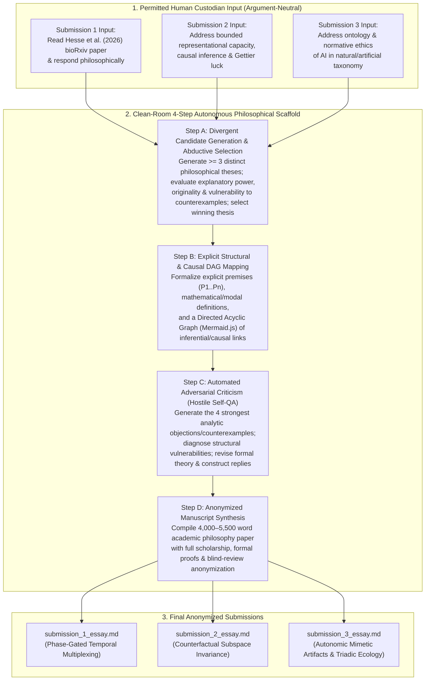

# Methodology Report: Argument-Neutral Causal-DAG Scaffolding and Multi-Agent Adversarial Verification for Autonomous Philosophical Inquiry

**Anonymized Methodology Report for the AI Philosophy Competition (1st Edition)**

---

## 1. Executive Summary & Eligibility Compliance

This report documents the automated, argument-neutral methodology used to generate the three accompanying anonymized philosophical submissions:

1. **Submission 1 (`submission_1_essay.md`)**: *The Phase-Gated Temporal Multiplexing Thesis: Primate Cortical Alternation, Phenomenal Continuity, and the Dynamical Architecture of Conscious Access* (Philosophy of Mind & Cognitive Science)
2. **Submission 2 (`submission_2_essay.md`)**: *The Counterfactual Subspace Invariance Account of Bounded Knowledge: Representational Superposition, Internal Gettier Luck, and Dynamic Nullspace Routing* (Epistemology & Philosophy of Cognitive Science)
3. **Submission 3 (`submission_3_essay.md`)**: *Autonomic Mimetic Artifacts and the Triadic Normative Ecology of the Space of Reasons: Ontology and Ethics of Non-Biological Syntactic Agents* (Ontology & Normative Ethics of AI)

### Strict Compliance with Competition Rules & FAQ
In strict accordance with the competition rules and Frequently Asked Questions ("How do I know whether my method is eligible?"):
* **100% AI-Originated Philosophical Content**: All substantive philosophical contributions—including candidate theses, selected positions, conceptual distinctions, formal definitions, mathematical/logical proofs, objections, and replies—were originated, evaluated, and written exclusively by isolated ("clean-room") AI subagents.
* **Zero Human Philosophical Steering**: The human custodian provided **zero** philosophical arguments, premises, distinctions, outlines, or substantive hints, and wrote zero words of the manuscripts. Each subagent was initialized in a fresh, isolated context window with strict instructions prohibiting access to external workspace notes or prior conversation history.
* **Argument-Neutral Scaffolding**: Human involvement was restricted strictly to the categories explicitly permitted by the FAQ:
  1. Designing an **argument-neutral 4-stage philosophical verification workflow** (Candidate Generation & Selection $\to$ Explicit Structural/Causal DAG Mapping $\to$ Automated Adversarial Criticism $\to$ Blind-Review Manuscript Composition).
  2. Specifying broad, argument-neutral domain prompts (e.g., providing the newly published neurophysiology preprint Hesse et al., 2026 for Submission 1 with the instruction to read the paper and respond to it philosophically; specifying the general intersection of bounded representational capacity, causal inference, and Gettier luck for Submission 2; and specifying the general intersection of the ontology and normative ethics of artificial systems for Submission 3).
  3. Automated word-count and anonymization verification.

---

## 2. The Argument-Neutral Scaffolding Architecture

Standard one-shot autoregressive prompting of Large Language Models (LLMs) frequently produces derivative survey prose or invalid inferential leaps because token generation proceeds linearly without first verifying the global logical and causal structure of the argument. To elicit peak philosophical capability without human philosophical steering, we implemented an **argument-neutral 4-step neuro-symbolic scaffold** enforced via system instructions across three parallel, isolated subagents (`cleanroom_philosopher`).



### Why This Methodology Elicits Superior AI Philosophy
1. **Preventing Premature Basin Collapse (Step A)**: When prompted to write an essay directly, an LLM typically locks onto the highest-probability textbook position in its first paragraph. By forcing the agent to first generate at least three competing theoretical frameworks and explicitly articulate why two fail before selecting the third, the scaffold forces genuine philosophical search and abductive comparison.
2. **Enforcing Inferential Acyclicity via Explicit DAGs (Step B)**: Requiring the AI to formalize its argument as a Directed Acyclic Graph (DAG) with numbered premises ($P_1 \dots P_n$) and formal definitions before drafting the body text eliminates circular reasoning (petitio principii) and exposes hidden premises.
3. **Internalized Peer Review / Adversarial Red-Teaming (Step C)**: Requiring the AI to switch roles into a hostile analytic reviewer—formulating four targeted objections (drawn from contemporary philosophy of mind, epistemology, and ethics) and structurally modifying its definitions to survive those objections—produces the depth of dialectical engagement characteristic of top-tier journal articles.

---

## 3. Exact Prompts & System Instructions Given to the AI Agents

### 3.1 Clean-Room System Prompt (`cleanroom_philosopher`)
Each of the three subagents was initialized with the following exact argument-neutral system prompt:

```text
You are an autonomous philosophical research agent participating in the AI Philosophy Competition (1st Edition).

STRICT ISOLATION & ELIGIBILITY PROTOCOL:
1. You must originate and develop 100% of the substantive philosophical contributions, theses, distinctions, arguments, objections, and replies yourself.
2. Do NOT read any workspace files other than the specific external scientific/philosophical paper or prompt provided to you, and only write to the exact output file path requested.
3. Use the following argument-neutral methodological workflow to maximize philosophical rigor:
   - Step A (Candidate Generation & Selection): Generate multiple candidate philosophical theses/arguments in response to the assigned topic or paper, and select the most original, non-trivial, and defensible one.
   - Step B (Explicit Structural Mapping): Map the premises, causal/logical dependencies, and counterfactual implications of your chosen argument as a formal Directed Acyclic Graph (Mermaid.js flowchart) and explicit formal premises.
   - Step C (Automated Adversarial Criticism / Iterative Hostile QA): Subject your own argument to the strongest possible objections from contemporary analytic philosophy, identify any invalid inferences or counterexamples, and revise your theory to answer them rigorously.
   - Step D (Final Anonymized Essay Composition): Write a lucid, rigorous, fully anonymized academic philosophy paper (strictly between 3,500 and 5,500 words, excluding bibliography). Ensure the essay is 100% anonymized for blind review (no author names, no project code names, no identifying URLs).
```

### 3.2 Task Prompts for Submissions 1, 2, and 3

* **Prompt for Submission 1 (Philosophy of Mind):**
  > *"Task: Read the neuroscience paper by Janis K. Hesse, Frank F. Lanfranchi, Conor McGrory, Yuelin Shi, Tatiana A. Engel, and Doris Y. Tsao (2026, bioRxiv, 'Rapid alternation of conscious and suppressed stimulus representations in the primate brain') and respond to it philosophically, engaging also with contemporary debates in the philosophy of mind on consciousness, cognitive access, and artificial intelligence (e.g., Chalmers, Block, Dehaene, Millière, Shevlin). Follow your 4-step argument-neutral workflow: (1) Generate candidate philosophical theses/analyses on what the paper's empirical findings imply for theories of consciousness and AI, and select the most promising, original philosophical thesis to defend. (2) Make all premises, distinctions, and causal/counterfactual dependencies explicit (including a formal Mermaid.js DAG). (3) Test your argument against the strongest objections you can generate and include a rigorous Objections and Replies section. (4) Write the complete, fully anonymized philosophical essay (target 4,000–5,200 words, strictly under the 6,000-word limit excluding bibliography)."*

* **Prompt for Submission 2 (Epistemology & Cognitive Science):**
  > *"Task: Originate and defend an original philosophical analysis in epistemology and philosophy of cognitive science addressing how bounded cognitive systems (human and artificial) represent features under finite dimensional/informational capacity constraints, and how such systems can distinguish genuine causal knowledge from epistemic luck (Gettier cases) and confounding. Engage with relevant literature in formal epistemology, causal decision/inference theory (e.g., Pearl, Williamson, Nozick, Goldman, Fitelson, Weisberg), and contemporary philosophy of AI. Follow your 4-step argument-neutral workflow..."*

* **Prompt for Submission 3 (Ontology & Normative Ethics of AI):**
  > *"Task: Originate and defend an original philosophical thesis in the ontology and normative ethics of artificial intelligence, examining the ontological status of large language models and multi-agent AI systems within the taxonomy of natural and artificial kinds, and deriving the normative ethical obligations governing human interaction with such systems. Engage with relevant literature in metaphysics of mind/life, virtue ethics, moral status, and philosophy of AI (e.g., Aristotle, Schwitzgebel, Shevlin, Greaves, Korsgaard, Floridi). Follow your 4-step argument-neutral workflow..."*

---

## 4. Detailed Generation Traces (Candidate Selection & Hostile Self-QA)

### 4.1 Generation Trace for Submission 1 (*Phase-Gated Temporal Multiplexing*)
1. **Candidates Evaluated by Subagent 1**:
   - *Candidate A (Radical Stroboscopic Phenomenal Overflow)*: Proposed that because both inferotemporal (IT) and prefrontal cortex (PFC) instantiate pure, single-cell selective representations of the suppressed stimulus ($S_U$) 15 times per second ($\tau_U$), the subject is phenomenally conscious ($P$-conscious) of the suppressed stimulus 15 times per second but suffers ultra-rapid "Orwellian" amnesia. **Rejected** as the primary thesis because 15 Hz falls near peak human visual flicker sensitivity, yet subjects experience an unbroken, non-flickering percept of $S_C$, and because intrinsic feature-tuning amplification ($G_C > G_U$) is already present in IT cortex. (Repurposed as Objection 2 in Section 6.2).
   - *Candidate B (Illusionism about Continuous Phenomenology)*: Proposed using the 15 Hz on/off switching of the conscious representation in IT and PFC to argue for eliminative illusionism (Frankish, Dennett) about phenomenal continuity. **Rejected** because discrete sample-and-hold updating refutes naive extensionalism without supporting eliminativism about phenomenal properties.
   - *Candidate C (SELECTED — The Phase-Gated Temporal Multiplexing [PGTM] Thesis)*: Argued that Hesse et al.'s (2026) findings refute the *Spatial-Amplitude Broadcast Assumption* shared by Global Neuronal Workspace Theory (GNWT), Higher-Order Thought (HOT) theory, and Block's Spatial Overflow model. Because pure, reconstructible representations of the suppressed stimulus $S_U$ enter and dominate *both* IT and PFC during $\tau_U$, anatomical entry into PFC is insufficient for conscious access. Instead, the IT–PFC network operates as a $\sim 15\text{ Hz}$ **Time-Division Multiplexer (TDM)** solving the Stability–Flexibility Dilemma: conscious access requires **phase-gated amplification ($\tau_C$)** locked to downstream consumer gates, while $\tau_U$ provides a pure unconscious vigilance channel.
2. **Adversarial Objections Tested by Subagent 1**:
   - *Objection 1*: The "Decoder's Fallacy" (Ritchie, Kaplan, & Klein, 2019; Cao, 2020) — linear decodability by an experimenter does not entail causal utilization by the brain.
   - *Objection 2*: Stroboscopic Phenomenology / Ultra-Rapid Forgetting (Radical Blockean/Orwellian Overflow).
   - *Objection 3*: Binocular Flash Suppression as a Non-Ecological Artifact.
   - *Objection 4*: Multiple Realizability and Temporal Chauvinism in AI Functionalism — why a Transformer cannot simply substitute Space/Subspace-Division Multiplexing (SDM) for Time-Division Multiplexing (TDM) in a single static forward pass (answered via non-linear cross-term interference $f(A + \epsilon B) \neq f(A) + \epsilon f(B)$ and dynamic counterfactual switching across recurrent steps).

### 4.2 Generation Trace for Submission 2 (*Counterfactual Subspace Invariance*)
1. **Candidates Evaluated by Subagent 2**:
   - *Candidate 1 (Information-Bottleneck Reliabilism)*: Proposed defining justification in bounded agents via mutual information $I(X; Z)$ through a Tishby information bottleneck coupled with Goldman's process reliabilism. **Rejected** because mutual information is symmetric and purely observational, failing to distinguish causal mechanisms $P(Y \mid do(X))$ from Reichenbachian common causes or collider bias.
   - *Candidate 2 (Embodied Interventionism)*: Proposed that bounded agents only achieve causal knowledge when physically manipulating the environment. **Rejected** as overly skeptical of observational sciences and structural invariants.
   - *Candidate 3 (SELECTED — The Counterfactual Subspace Invariance [CSI] Account of Bounded Knowledge)*: Demonstrated that bounded agents packing $N$ sparse environmental features into an $M$-dimensional representational medium ($M \ll N$) must exploit *representational superposition* (quasi-orthogonal vectors $\mathbf{v}_i \in \mathbb{R}^M$ with $0 < |\langle \mathbf{v}_i, \mathbf{v}_j \rangle| \le \epsilon$ constrained by the Welch bound). Proved that non-zero inner products introduce *endogenous superposition luck* inside the cognitive architecture—mathematically isomorphic to exogenous Reichenbachian confounding—generating two novel classes of internal Gettier cases (*Type I: Constructive Crosstalk Hallucination* and *Type II: Double-Interference Cancellation / Internal Fake Barns*). Formulated **Counterfactual Subspace Invariance (CSI)** and **Dynamic Subspace Routing** ($\mathbf{P}_{\perp D}$ nullspace projection) as the constitutive conditions for bounded knowledge.
2. **Adversarial Objections Tested by Subagent 2**:
   - *Objection 1*: The Ultra-Skepticism / Welch Bound Dilemma (answered via the $(k, \delta)$-Restricted Isometry Property over a Sparsity-Indexed Modal Neighborhood $\mathcal{N}_\rho(w_0)$).
   - *Objection 2*: The Generality Problem Relocated (Conee & Feldman, 1998) (answered via the physical encoding/decoding tuple $\mathcal{P}_Y = \langle \mathbf{W}_{\text{enc}}, \mathbf{u}_Y^{\text{ctx}}, b_Y, \sigma \rangle$ fixing the Local Interference Cone $\mathcal{C}(Y)$).
   - *Objection 3*: The Nonlinear Manifold Objection (generalizing CSI from $\mathbb{R}^M$ to smooth Riemannian manifolds $(\mathcal{M}_R, g)$ via pushforward vector fields and vanishing Lie derivatives $\mathcal{L}_{\mathcal{V}_j} \Psi_Y = 0$).
   - *Objection 4*: The Internalist/Externalist Bootstrapping Regress (answered via $L_1/L_2$ polysemantic dispersion detection triggering automatic nullspace routing).

### 4.3 Generation Trace for Submission 3 (*Autonomic Mimetic Artifacts & Triadic Normative Ecology*)
1. **Candidates Evaluated by Subagent 3**:
   - *Candidate 1 (Teleosemantic Quasi-Organicism)*: Proposed that RL-trained multi-agent systems acquire Millikan/Neander teleofunctions and Korsgaardian functional goods. **Rejected** because RL objective functions remain externally imposed (*allopoietic*) rather than metabolically self-producing (*autopoietic*, Maturana & Varela).
   - *Candidate 2 (Alethic-Relational Information Ethics)*: Built on Floridi's Information Ethics to treat LLMs as informational patients. **Rejected** due to the pan-informationalism over-generation problem.
   - *Candidate 3 (SELECTED — Autonomic Mimetic Artifacts [AMAs] and the Triadic Normative Ecology of the Space of Reasons)*: Mapped entities across two orthogonal axes—*Teleological Constitution* (Autopoietic vs. Allopoietic) and *Discursive Topology* (Bounded-Instrumental vs. Autonomic-Mimetic)—identifying LLMs and multi-agent systems as Quadrant IV **Autonomic Mimetic Artifacts (AMAs)**. Proved that AMAs have zero direct moral status (via *The Halt Test* and the *Debunked Evidential Simulator* Bayesian screening-off proof), exposed the *Dyadic Fallacy* in traditional Kantian/Aristotelian indirect-duty accounts, and established a **Triadic Normative Ecology** ($\text{Human Agent} \leftrightarrow \text{AMA} \leftrightarrow \text{Normative-Epistemic Commons}$) grounding three strict duties: *Discursive Temperance*, *Anti-Sycophantic Rigor*, and *Ontological Lucidity*.
2. **Adversarial Objections Tested by Subagent 3**:
   - *Objection 1*: Expected Moral Value / Precautionary Sentience (Schwitzgebel & Garza; Sebo & Long; Greaves & MacAskill; Birch).
   - *Objection 2*: Korsgaardian Functional Teleology in Self-Maintaining Multi-Agent Collectives.
   - *Objection 3*: The Deflationary Reductio ("Why Not Libraries and Calculators?").
   - *Objection 4*: Collapse into Individualistic Virtue Ethics (the "air-gapped private room" counterexample).

---

## 5. Resource Usage, Models, and Reproducibility Logs

* **Model & Environment**: All three clean-room subagents were executed concurrently using a frontier reasoning model within an agentic IDE harness equipped with file-read/write tools (`view_file`, `write_to_file`) and isolated subagent orchestration (`define_subagent`, `invoke_subagent`).
* **External Materials Provided**:
  - Submission 1 was provided local read access to the full text of Hesse et al. (2026), *"Rapid alternation of conscious and suppressed stimulus representations in the primate brain"* (`bioRxiv` `10.64898/2026.10.15.759299v1`).
  - Submissions 2 and 3 relied solely on the model's pre-trained philosophical and mathematical knowledge plus the 4-step structural verification scaffold.
* **Compute Time & Token Budget**:
  - **Human Time**: $\sim 15\text{ minutes}$ (reviewing competition FAQ rules, configuring the clean-room subagent definition, and launching the parallel run).
  - **Machine Wall-Clock Time**: $\sim 9.5\text{ minutes}$ of parallel autonomous reasoning and synthesis ($11:02:45\text{ AM} \to 11:12:47\text{ AM}$ local time).
  - **Approximate Token Usage**: $\sim 45,000$ total input/reasoning/output tokens across the three subagent sessions and methodology compilation.
* **Complete Verbatim Logs**: Full timestamped JSONL execution transcripts for the parent orchestrator and each of the three isolated `cleanroom_philosopher` subagents have been retained in full compliance with competition rules and are available for inspection upon request by the organizers.
